# BOOKING_FLOW_AUDIT — come funziona davvero una richiesta di tavolo

> FIX-1, 21/10/2026, branch `fix-1`. Ricostruito **dal codice**, non dai documenti di progetto. Per ogni punto: com'era
> prima di FIX-1, i problemi trovati, cosa è cambiato in FIX-1, il comportamento finale. Percorsi relativi a
> `backend/src/main/java/it/fireflies/` e `frontend/src/`.

## 0. Diagramma di sequenza (comportamento finale)

```mermaid
sequenceDiagram
    autonumber
    actor C as Cliente (sito)
    participant F as BookingDialog.tsx
    participant API as ReservationController
    participant S as ReservationService
    participant L as WebRequestLimiter
    participant DB as PostgreSQL
    actor G as Gestore (Richieste)
    participant W as NotificationWorker

    C->>F: «Richiedi un tavolo» → «Prenota un tavolo»
    F->>API: GET /public/booking-options (regole, giorni chiusi)
    API->>L: read(ip) — 120/min
    API->>DB: booking_policies, opening_hours, opening_exceptions, booking_exceptions, service_windows
    F->>API: GET /public/booking-options?date&guests (orari del giorno)
    API->>DB: capacity_slots (sola lettura, nessun lock)
    C->>F: giorno → orario → persone → dati → «Invia la richiesta»
    F->>API: POST /public/reservations + Idempotency-Key + X-XSRF-TOKEN
    API->>S: createWeb() @Transactional
    S->>DB: reservations by idempotency_key (reinvio → stessa ricevuta)
    S->>L: attempt(ip) — 30 / 10 min
    S->>DB: policy, fasce, chiusure, capacity_slots (anteprima non vincolante), richieste del telefono in 24 h
    S->>L: create(ip) — 10 / ora, solo ora che si salva
    S->>DB: INSERT reservations (PENDING) + reservation_status_history + notification_outbox + audit_logs
    API-->>F: 201 ricevuta (riferimento) — oppure 422/429 con messaggio
    G->>API: GET /admin/reservations (schede Richieste)
    G->>API: PATCH /admin/reservations/{id}/status CONFIRMED (version)
    API->>S: changeStatus() @Transactional
    S->>DB: SELECT … FOR UPDATE (prenotazione) → [evento FOR UPDATE] → zona FOR SHARE → quanti FOR UPDATE in ordine
    S->>DB: UPDATE capacity_slots occupied_covers (+ persone), ck_slot_not_overbooked come ultima difesa
    S->>DB: UPDATE reservations CONFIRMED + storico + outbox (RESERVATION_CONFIRMED) nella stessa transazione
    W->>DB: presa in carico outbox (SKIP LOCKED, solo se il worker è acceso: in produzione spento)
```

## 1. Come il cliente apre il modulo
- **Prima e ora**: `components/BookingDialog.tsx`, aperto da `store.openBooking()` (pulsanti «Richiedi un tavolo», rotta
  `#/prenota` in `App.tsx`). Prima scelta: «Prenota un tavolo» o «Organizza un evento / compleanno» (telefono del
  locale, FASE 8). Le serate in calendario aprono direttamente il modulo con `eventId`.
- Passi: 0 giorno, 1 orario, 2 persone, 3 dati, 4 riepilogo e invio (`step`).

## 2. Caricamento delle date disponibili
- `GET /api/v1/public/booking-options` senza data (`ReservationController.bookingOptions` →
  `BookingOptionsService.options`): `webBookingEnabled`, `maxPartySize`, `maxAdvanceDays`, `minLeadMinutes`,
  `firstDate`, `lastDate`, `closedDates` (`BookingCalendar.closedDays`). Risposta `no-store`.
- Il dialog mostra 14 giorni come chip e un campo data; i giorni in `closedDates` sono disabilitati.
- **FIX-1**: le letture hanno un limite proprio (120 al minuto per indirizzo, `WebRequestLimiter.read`), separato
  dagli invii: consultare non consuma mai il limite delle richieste.

## 3. Giorni di chiusura e aperture straordinarie
- `BookingCalendar.venueOpen(date)`: una data straordinaria (`opening_exceptions`) decide; altrimenti il giorno della
  settimana di `opening_hours` (`DiningStore.weeklyClosed`). `BookingCalendar.closed(date, windowId)` aggiunge le fasce
  chiuse agli arrivi (`booking_exceptions`, kind `CLOSED`).
- **Prima**: una data straordinaria era un solo giorno (`opening_exceptions.day` UNIQUE): una settimana di ferie
  richiedeva 7 inserimenti.
- **FIX-1 (V12)**: `opening_exceptions.end_day`, intervalli con estremi compresi, una riga per intervallo
  (inserimento e modifica atomici), vincolo `ex_opening_exception_overlap` (EXCLUDE gist su `daterange`) contro
  giorni sovrapposti anche con salvataggi contemporanei; API `POST/PUT/DELETE /admin/opening-exceptions` (solo
  titolare). Le prenotazioni già presenti nei giorni chiusi **non** vengono cancellate: la risposta elenca per giorno
  quante sono (in attesa, confermate, persone) e l'interfaccia lo segnala.

## 4. Determinazione della fascia
- Dal sito l'orario deve essere un **arrivo** di una fascia aperta quel giorno: `ReservationService.webSlot` +
  `arrivalOf` (primo/ultimo arrivo, passo `slot_minutes`); permanenza = `default_duration_minutes` della fascia.
- La fascia di riepilogo (Colazione, Pomeriggio, Aperitivo, Sera) la decide `dining/Band.of(nome, orario)`.
- Inserimenti dei gestori: `BookingCalendar.windowFor` (prima la fascia in cui l'orario è un arrivo, T-70).

## 5. Calcolo dei posti disponibili
- Registro a quanti di 15 minuti (`capacity_slots`): per ogni quanto `capacity_covers` e `occupied_covers` (solo
  prenotazioni **confermate**). `CapacityLedger.read` legge senza lock; i quanti mancanti valgono la capienza calcolata.
- **Prima**: capienza effettiva = minimo tra capienza fisica della zona, `service_windows.max_covers` della fascia e
  `booking_exceptions` `CAPACITY_OVERRIDE` della data (`DiningSlotCapacityPolicy`). Tre posti dove configurarla.
- **FIX-1 (V12)**: una sola fonte, `capacity_zones.physical_capacity` = «Capienza massima del locale», uguale per ogni
  giorno e fascia (`DiningSlotCapacityPolicy.capacityFor` restituisce la capienza fisica). Colonne e limiti per
  fascia/data rimossi; i quanti già creati riallineati alla capienza del locale (mai sotto i confermati).
- Al pubblico arrivano solo sì/no per orario (`available`, `reason`: TOO_EARLY, DAY_CLOSED, FULL, EVENT), mai numeri.

## 6. Campi del cliente
Giorno, orario, persone, nome, telefono (obbligatorio), email (facoltativa), note (facoltative), presa visione della
privacy (obbligatoria), campo nascosto `website` (trappola per i programmi automatici).

## 7. Validazioni
- **Frontend** (`BookingDialog.validate`): data non passata, non oltre `lastDate`, non chiusa; orario scelto; persone
  1…`maxPartySize`; nome ≥ 2 lettere; telefono 6–20 caratteri; email valida; privacy.
- **Backend, vincolanti** (`ReservationService.createWeb`): `Idempotency-Key` obbligatoria; `website` vuoto; nome 2–80;
  telefono normalizzato (`PhoneNumbers.normalize`); email; note ≤ 500; privacy; richieste dal sito aperte; persone ≥ 1
  e ≤ limite del sito; data entro `max_advance_days`; orario = arrivo di una fascia aperta; anticipo minimo; per gli
  eventi: evento prenotabile e posti nella quota. Vincoli del database come ultima difesa (`ck_res_web_privacy`,
  `ux_res_web_duplicate`, `ux_res_idempotency_key`, …).
- **Prima**: persone massime dal sito = impostazione separata (`max_party_size_web`, 12).
- **FIX-1**: impostazione rimossa (ridondante con la capienza unica). Limite = capienza del locale, mai oltre un tetto
  fisso di 30 persone per richiesta (`BookingCalendar.WEB_PARTY_CEILING`): non è configurabile, evita che una richiesta
  automatica blocchi metà del locale e non rivela la capienza vera; i gruppi più grandi passano dal telefono.

## 8. Clic su «Invia la richiesta»
- `submit()` chiama `sendRequest(body, keyRef.current)`. La chiave (`newIdempotencyKey`) cambia solo se cambiano i dati
  (`set()`), quindi ogni reinvio dello stesso contenuto usa la stessa chiave.
- **Prima**: la protezione dal doppio tocco era lo stato React `sending`: due tocchi nello stesso istante potevano
  partire entrambi; il secondo, perdendo sul vincolo della chiave, mostrava «Richiesta già inviata… attendi» pur essendo
  andato tutto bene.
- **FIX-1**: blocco sincrono `submittingRef`; pulsante disabilitato con «Invio in corso…» e indicatore; errori di rete
  e 5xx spiegano che il nuovo tentativo non duplica; 429 mostra il messaggio del server con l'attesa.

## 9. Endpoint chiamati
`GET /api/v1/auth/csrf` (token), `GET /api/v1/public/booking-options[?date&guests]`, `POST /api/v1/public/reservations`
(intestazioni `Idempotency-Key`, `X-XSRF-TOKEN`). Area gestori: `GET /api/v1/admin/reservations`, `GET …/{id}`,
`PATCH …/{id}/status`, `PATCH …/{id}`, `POST /api/v1/admin/reservations` (inserimento manuale).

## 10. Quando nasce la riga in PostgreSQL
In `createWeb`, transazione unica (`@Transactional`): `ReservationStore.insert` (stato `PENDING`, sorgente `WEB`,
zona, inizio/fine, impronta dei dati, chiave, versione privacy) → `store.history` → `notify(…RESERVATION_NEW_FOR_VENUE /
RESERVATION_RECEIVED)` in `notification_outbox` → `audit_logs` (senza dati personali). Se qualcosa fallisce non resta
nulla. Una richiesta `PENDING` **non occupa posti**.

## 11. Prevenzione del doppio invio
- Stessa chiave + stessi dati → stessa ricevuta (`store.byIdempotencyKey`, impronta `fingerprint`); stessa chiave con
  dati diversi → `422 IDEMPOTENCY_KEY_REUSED`.
- `ux_res_web_duplicate`: stesso telefono e stesso orario con una richiesta attiva → `409 DUPLICATE_REQUEST`.
- **FIX-1**: due invii identici contemporanei: il secondo perde su `ux_res_idempotency_key`;
  `ReservationController.createWeb` lo intercetta e ripete in una nuova transazione, che trova la riga del primo e
  restituisce **la stessa ricevuta** (`WebRateLimitIT.doppioInvioContemporaneoUnaSolaRichiesta`: 6 invii paralleli, una
  riga, sei risposte 201 uguali).

## 12. Rate limiting
- **Prima**: un solo contatore per IP, 5 richieste all'ora, chiamato **prima** di tutti i controlli
  (`limiter.acquire` subito dopo il controllo della chiave). Ogni invio rifiutato (orario non valido, giorno chiuso,
  privacy dimenticata, gruppo troppo grande, orario pieno) consumava il limite: dopo 5 tentativi — anche senza nessuna
  richiesta salvata — compariva «Hai inviato molte richieste in poco tempo», per un'ora. Con più clienti dietro lo
  stesso IP (wifi di casa, ufficio, rete mobile con NAT) e nelle prove manuali in locale (tutto da 127.0.0.1) il blocco
  arrivava presto. Nessun limite sulle letture. Messaggio senza l'attesa.
- **Cause escluse con i test**: nessuna chiamata ripetuta automatica né retry automatici nel frontend (il client fa un
  solo tentativo, salvo il rinnovo del token CSRF dopo un `403 CSRF_INVALID`); le letture degli orari non toccavano il
  limite; l'IP dietro proxy è corretto (FASE 8, `ProxyHeadersIT`).
- **FIX-1** (`reservation/WebRequestLimiter`, tre finestre scorrevoli per IP, in memoria):

  | Contatore | Cosa conta | Limite | Esito |
  |---|---|---|---|
  | letture | `GET booking-options` | 120 al minuto | `429` + `Retry-After` |
  | tentativi | ogni `POST`, anche rifiutato (non i reinvii con la stessa chiave) | 30 in 10 minuti | `429` + `Retry-After` |
  | richieste create | solo quando la richiesta viene salvata | 10 all'ora | `429` + `Retry-After` |
  | per telefono (database) | richieste dal sito dello stesso numero | 3 in 24 ore | `429` |

  Messaggi con l'attesa residua («riprova tra 12 minuti o chiamaci», `ReservationService.waitText`); pulizia periodica
  degli indirizzi inattivi (la memoria non cresce). Nessun CAPTCHA né servizio esterno: i limiti e la trappola
  `website` bastano al volume di un locale; da rivalutare solo con abusi reali.

## 13. Cosa vede il gestore in Richieste
`pages/admin/Requests.tsx` → `GET /admin/reservations` (`ReservationQueries.search`): schede con stato, data, ora,
persone, nome, telefono, origine, «Da richiamare», contatori per stato. Il dettaglio (`GET …/{id}`) mostra capienza del
momento (`capacity.fits`, posti minimi liberi, altre richieste in attesa nello stesso orario), storico, notifiche
(«Simulata: nessun messaggio reale» in locale, «preparata, non inviata» in produzione), azioni possibili.

## 14. Conferma o rifiuto
`PATCH /admin/reservations/{id}/status` con `version` (blocco ottimistico, `409` se un altro gestore ha già cambiato
la richiesta) → `ReservationService.changeStatus`: `store.lock(id)` (`SELECT … FOR UPDATE`), stesso stato = nessun
effetto (doppio clic), transizioni ammesse esplicite. Conferma → `confirm()`; rifiuto/annullamento → `close()` con
motivo; scadenza automatica delle richieste non gestite: `PendingExpiryJob` → `expirePending()` (REJECTED/EXPIRED).

## 15. Quando si occupano e si liberano i posti
- Occupati **solo alla conferma**: `CapacityLedger.occupy` / `occupyForEvent` aggiunge le persone a tutti i quanti della
  permanenza.
- Liberati: annullamento di una confermata (`cancelConfirmed` → `ledger.release`), «Completata»/«Non presentato» (i
  quanti futuri, `finish`), modifica (`ledger.change`: si controlla solo la differenza netta).

## 16. Niente overbooking con conferme concorrenti
Ordine dei lock fisso: prenotazione (`FOR UPDATE`) → evento (`EventBooking.lock`) → zona (`FOR SHARE`;
`FOR NO KEY UPDATE` quando cambia la capienza) → quanti in ordine di orario (`CapacitySlotStore.lockSlots`,
`ORDER BY slot_start FOR UPDATE`). Controllo `occupied + persone ≤ capacity` sotto lock; se un quanto non basta
`409 CAPACITY_EXCEEDED` e tutta la transazione si annulla. Ultima difesa: vincolo `ck_slot_not_overbooked`. Cambiare la
capienza del locale prende la zona in esclusiva e ricalcola i quanti futuri: sotto i confermati → `409
CAPACITY_BELOW_CONFIRMED` con data, ora e persone. Provato: `ReservationConcurrencyIT`, `OperationsIT`
(`capienzaConcorrenteMaiOltreIlLimite`, **FIX-1** `riduzioneDellaCapienzaConConfermeContemporanee`).

## 17. Prenotazioni per gli eventi
Il modulo di una serata manda `eventId`: `bookableEvent` (pubblicato, «su richiesta», non troppo vicino, posti nella
quota). Alla conferma: `EventBooking.acquire` (quota dell'evento, `events.capacity_covers`) **e** registro della zona
nella stessa transazione: i quanti riservati in esclusiva a quell'evento sono ammessi, gli altri no. Un evento
esclusivo blocca le richieste ordinarie (`EVENT_BLOCKS_SLOT`). Annullare un evento: `cancelForEvent`.

## 18. Notifiche
Create **nella stessa transazione** del cambio di stato (`notify` → `NotificationOutbox.enqueue`, chiave
`RES:{id}:{modello}:{versione}:{canale}`, scadenza = fine della prenotazione). Processate da `NotificationWorker` /
`NotificationDispatcher.runOnce` (lease con `SKIP LOCKED`, tentativi, superamento dei messaggi vecchi). **Gateway solo
finti; in produzione il worker è spento** (l'avvio si rifiuta se acceso senza provider: V-05).

## 19. Eliminazione delle vecchie prenotazioni
`RetentionJob` (02:00–05:00 Europe/Rome, ogni ora) → `RetentionService.runIfDue`: una sola esecuzione al giorno grazie a
`maintenance_runs (job, giorno)`; prenotazioni finite da almeno un mese (mai future o in corso, salvo notifiche ancora
da inviare), in lotti con `SKIP LOCKED`; poi quanti passati, eventi dopo 2 mesi, notifiche finali dopo 90 giorni, audit
dopo 12 mesi.

## 20. Statistiche anonime
Prima di cancellare, `RetentionService` somma per giorno e fascia in `reservation_stats` (richieste, confermate,
persone, rifiutate, annullate, scadute, non presentati, dal sito, per eventi, capienza minima): nessun nome, telefono,
email, nota o riferimento. Il riepilogo dei gestori (`OperationsService.summary`) le somma ai dati vivi. **FIX-1**:
vista una settimana alla volta, una fascia per volta (`GET /admin/capacity-summary?from&to&band=`).

## 21. Problemi trovati
| # | Problema | Gravità | Stato |
|---|---|---|---|
| P-1 | Limite per IP consumato anche dagli invii rifiutati (5/ora): clienti legittimi bloccati | alta (UX) | **corretto** (§12) |
| P-2 | Nessun limite sulle letture della disponibilità (ognuna legge il registro) | media | **corretto** (§12) |
| P-3 | Doppio invio contemporaneo: errore mostrato al cliente anche se la richiesta era salvata | media | **corretto** (§8, §11) |
| P-4 | 403 dello staff su API del titolare con percorso lungo (es. `/admin/service-windows/{id}`) diventava 500: `audit_logs.object_id` > 64 caratteri | media (sicurezza/robustezza) | **corretto** (`SecurityProblemHandlers`, `ApiSecurityMatrixIT`) |
| P-5 | Capienza configurabile in tre posti (zona, fascia, data): incoerenze possibili (demo: colazione 20, resto 40) | media | **corretto** (§5, V12) |
| P-6 | Messaggio 429 senza l'attesa residua | bassa | **corretto** (§12) |
| P-7 | Date straordinarie solo giorno per giorno | bassa | **corretto** (§3) |
| P-8 | Limiti in memoria: si azzerano al riavvio, non condivisi tra più istanze | nota | invariato: una sola istanza in produzione (DEPLOY.md); con più istanze andrebbero su PostgreSQL |
| P-9 | L'anteprima dei posti all'invio non è vincolante: una richiesta accettata può non essere confermabile | nota (voluto) | invariato: la conferma manuale è il controllo vero; il dettaglio mostra se c'è posto |
| P-10 | Limite per telefono conta anche richieste rifiutate o annullate (3 in 24 ore) | nota (voluto) | invariato: antispam; il messaggio invita a chiamare |

## 22. Comportamento finale in breve
Il cliente consulta liberamente; corregge il modulo senza essere bloccato; un invio vale una sola richiesta anche con
doppio tocco o rete instabile; chi insiste a raffica riceve 429 con l'attesa. Le richieste restano in attesa senza
occupare posti; il gestore conferma e solo allora il server occupa i posti, sotto lock e mai oltre la capienza unica del
locale, anche con più conferme nello stesso istante. Chiusure di un giorno o di un intervallo bloccano il sito, senza
cancellare le prenotazioni esistenti.
