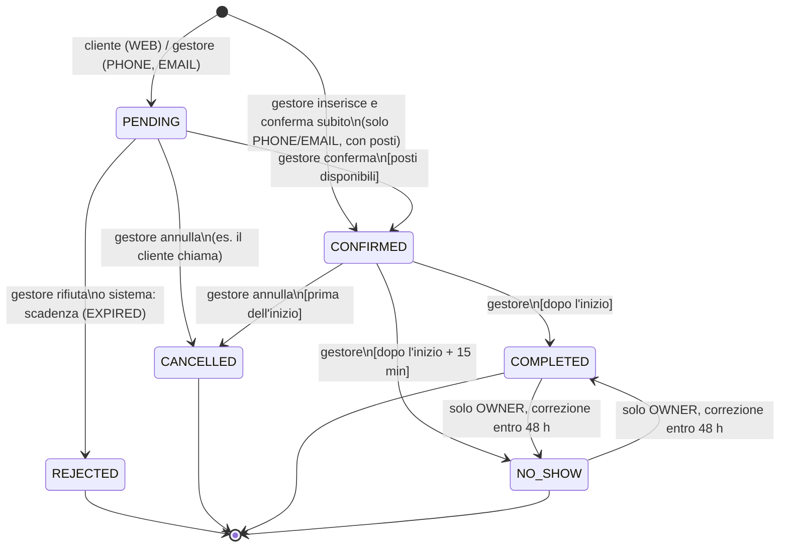

# Regole di prenotazione e capienza — V1

> FASE 1 · rev. 2 del 19/10/2026 (revisione finale) · Stato: **proposta da approvare**. Le voci **(P-nn)** richiedono il tuo OK (DECISION_LOG §3).
> Principio V1: **il cliente chiede, il gestore decide.** Nessuna conferma automatica, nessuna assegnazione automatica di tavoli.
> Cambiato rispetto alla rev. 1: la capienza non si conta più «per fascia di arrivo» ma **per presenza contemporanea su intervalli di tempo** (§3); eventi e servizio ordinario condividono la stessa capienza fisica (§7); tavoli con posti insufficienti bloccati salvo eccezione del titolare (§8); notifiche at-least-once (§9).

## 1. Concetti

| Termine | Significato |
|---|---|
| **Orari pubblici** | quando il locale è aperto (mostrati sul sito). Non decidono le prenotazioni. |
| **Zona di capienza** (`capacity_zone`) | spazio **fisicamente separato** con una capienza massima di persone presenti contemporaneamente, decisa dal titolare. Predefinito: **una sola zona «Locale»**. Più zone (es. «Sala», «Dehors») solo se fisicamente distinte. Le zone non si sovrappongono: la capienza totale del locale è la somma delle zone. |
| **Area** | raggruppamento di tavoli (es. «Bancone», «Tavoli alti»). Ogni area appartiene a una zona. Un'area **non** ha capienza propria. |
| **Fascia prenotabile** (`service_window`) | per zona e giorno della settimana: primo e ultimo orario di arrivo, passo (15/30/60 min), durata standard, e facoltativamente un **limite di presenze contemporanee** più basso della capienza fisica (es. staff ridotto). |
| **Quanto** | intervallo di 15 minuti allineato (`19:00`, `19:15`, …). Tutti gli orari di prenotazioni ed eventi sono multipli di 15 minuti. |
| **Registro di occupazione** (`capacity_slots`) | per ogni zona e quanto: capienza effettiva, persone confermate presenti, eventuale evento esclusivo. |
| **Richiesta** | prenotazione `PENDING`: non occupa posti. |
| **Eccezione** | per una data: fascia chiusa agli arrivi oppure limite di presenze diverso. |
| **Regole generali** (`booking_policy`) | anticipo minimo, giorni massimi, persone massime dal web, scadenza delle richieste, web on/off. Modalità di conferma: **sempre `MANUAL`**. |

Finché i titolari non configurano zona e fasce reali, **le prenotazioni dal sito restano disattivate**. I valori negli esempi sono dimostrativi.

## 2. State machine

| Da → A | Chi | Precondizioni | Effetti nella **stessa transazione** |
|---|---|---|---|
| — → PENDING | pubblico (WEB), STAFF/OWNER (PHONE/EMAIL) | validazioni §4; WEB anche §5 | riga + storico; outbox: email al locale (WEB), ricevuta al cliente se ha email |
| — → CONFIRMED | STAFF/OWNER, solo PHONE/EMAIL con `confirmNow` | come sotto | come PENDING → CONFIRMED |
| PENDING → CONFIRMED | STAFF/OWNER | `version` corrispondente; inizio nel futuro; zona determinata; **occupazione riuscita** (§3); per eventi anche quota evento (§7) | occupazione `[starts_at, ends_at)` registrata; `occupied_until = ends_at`; tavoli facoltativi (§8); storico; audit; outbox conferma |
| PENDING → REJECTED | STAFF/OWNER; sistema | motivo obbligatorio | storico; outbox avviso al cliente |
| PENDING → CANCELLED | STAFF/OWNER | motivo | storico |
| CONFIRMED → CANCELLED | STAFF/OWNER | prima di `starts_at` | **rilascio** di tutta l'occupazione e della quota evento; tavoli `active = false`; storico; outbox «annullata»; notifiche di conferma non ancora partite → `SKIPPED (SUPERSEDED)` |
| CONFIRMED → COMPLETED | STAFF/OWNER | `now ≥ starts_at` | se prima di `ends_at` (clienti andati via prima): rilascio dei quanti futuri, `occupied_until` = quanto successivo; tavoli accorciati |
| CONFIRMED → NO_SHOW | STAFF/OWNER | `now ≥ starts_at + 15 min` | rilascio dei quanti futuri; tavoli accorciati; quota evento rilasciata |
| NO_SHOW ↔ COMPLETED | solo OWNER | entro 48 h | solo storico (nessun effetto sui posti, già passati) |

**Idempotenza**: chiedere lo stato già attuale (doppio clic) → `200` invariato, nessuno storico, nessuna notifica. Transizioni non in tabella → `409 INVALID_TRANSITION`. L'API pubblica non può mai creare una prenotazione confermata.
**Lock ottimistico**: ogni comando del gestore porta `version`; se nel frattempo è cambiata → `409 VERSION_CONFLICT`.

## 3. Capienza per presenza contemporanea

### 3.1 Regola
In ogni zona e in ogni quanto: **persone confermate presenti ≤ capienza effettiva del quanto**.
Una prenotazione è presente nei quanti di `[starts_at, occupied_until)`. Due prenotazioni 19:00–21:00 e 20:00–22:00 contano **entrambe** tra le 20:00 e le 21:00, anche se arrivano in fasce diverse. Questo sostituisce il conteggio «solo nella fascia di arrivo» della rev. 1, che permetteva di superare la capienza reale.

### 3.2 Capienza effettiva di un quanto
**FIX-1 (T-78)**: una sola fonte, la **capienza massima del locale** (`capacity_zones.physical_capacity`), uguale per
ogni giorno e fascia: è il numero di persone presenti nello stesso momento, non un totale della giornata.
L'occupazione dipende solo dalle prenotazioni confermate, dalle sovrapposizioni di orario e dagli eventi. Giorni e
fasce chiusi non cambiano la capienza: bloccano gli arrivi (§13).
~~`min(capienza fisica, limite della fascia o eccezione del giorno)`~~ (fino alla FASE 8; limiti per fascia e per data
rimossi dalla V12).

### 3.3 Conferma: procedura transazionale
Una sola transazione PostgreSQL (`READ COMMITTED`):

1. lock ottimistico della prenotazione (`version`);
2. se è per un evento: `SELECT … FOR UPDATE` della riga evento (quota evento, §7);
3. `SELECT … FOR SHARE` della riga della **zona** (impedisce che un cambio di capienza avvenga a metà, §3.5);
4. creazione dei quanti mancanti con la capienza effettiva vigente (`INSERT … ON CONFLICT DO NOTHING`);
5. **lock di tutti i quanti dell'intervallo in ordine** (`ORDER BY slot_start FOR UPDATE`) — l'ordine fisso evita i deadlock tra intervalli sovrapposti;
6. controllo: nessun quanto bloccato da un evento esclusivo di altri (`409 EVENT_BLOCKS_SLOT`) e `occupied + persone ≤ capienza` in tutti i quanti (`409 CAPACITY_EXCEEDED`, con il primo orario saturo e i posti liberi);
7. aggiornamento di tutti i quanti (`occupied_covers += persone`) e della prenotazione;
8. assegnazione facoltativa dei tavoli (vincolo di esclusione, §8), storico, audit, outbox → commit.

Il vincolo `CHECK (occupied_covers <= capacity_covers)` resta come **ultima difesa** anche contro bug applicativi.
Ordine globale dei lock, uguale in ogni operazione (aggiornato in FASE 2, DECISION_LOG T-05): **prenotazione → evento → zona → quanti (per zona, poi orario) → righe dei tavoli in ordine di id → assegnazioni**. Un'operazione che tocca più prenotazioni (es. annullamento di un evento) le blocca in ordine di id.

Verificato su PostgreSQL 17 (spike 2): 60 conferme parallele con orari e durate casuali su capienza 10 → presenza massima 10, registro identico al ricalcolo, 0 deadlock.

### 3.3-bis Budget di persone per giorno e fascia (FIX 2, T-88)
Oltre ai posti contemporanei, **ogni fascia di ogni giorno** (Colazione, Pomeriggio, Aperitivo, Sera) accoglie al
massimo **«capienza del locale» persone confermate in totale**, indipendentemente dal ricambio dei tavoli. Con capienza
100: 60 persone alle 19:00 e 40 alle 21:00 nella stessa fascia esauriscono il budget, anche se alle 21:00 i primi sono
già usciti. La fascia di una prenotazione è quella di `dining/Band` (nome della fascia prenotabile, altrimenti l'orario
di arrivo: <05 sera, <11 colazione, <17 pomeriggio, <20 aperitivo, poi sera); una prenotazione per un evento conta
nella fascia dell'ora di inizio dell'evento.

| Passaggio | Budget della fascia |
|---|---|
| richiesta `PENDING` | non conta |
| `PENDING → CONFIRMED` | consuma le persone |
| `CONFIRMED → CANCELLED` | le restituisce |
| `PENDING → REJECTED/CANCELLED`, scadenza | nessun effetto |
| `CONFIRMED → COMPLETED` / `NO_SHOW` (e correzione tra i due) | **non** restituisce |
| modifica di giorno, fascia o persone di una confermata | vecchia fascia restituita e nuova occupata nella stessa transazione |

Il contatore `band_capacity_usage` (V13) lo aggiorna un trigger PostgreSQL sulle prenotazioni, nella stessa transazione
di ogni cambio: un cambio di stato ripetuto o una correzione non possono contare due volte. Il controllo «non oltre la
capienza» lo fa il backend **sotto lock della riga del contatore**, prima del registro dei quanti: oltre →
`409 BAND_CAPACITY_EXCEEDED` (contesto: giorno, fascia, capienza, confermate, restanti). Restano tutti e tre i controlli:
budget della fascia, posti contemporanei (§3.3, `CAPACITY_EXCEEDED`), quota ed esclusività degli eventi (§7). Il sito
non offre gli orari di una fascia il cui budget non basta (`reason: FULL`) e rifiuta l'invio (`422 FULLY_BOOKED`).

Ordine dei lock (FIX 2): **prenotazione → evento → zone `FOR SHARE` (per id) → righe del budget `FOR UPDATE` (per
giorno, fascia) → quanti**. Anche l'annullamento di una confermata blocca la riga del budget prima di liberare i quanti,
così conferme e annullamenti contemporanei non vanno in stallo. Il cambio di capienza del locale (§3.5) rifiuta anche
quando una fascia futura ha già più confermate della nuova capienza (`CAPACITY_BELOW_CONFIRMED`, `bandConflicts`).

### 3.4 Rilascio e modifiche
- Annullamento: `occupied_covers -= persone` su tutti i quanti occupati.
- Uscita anticipata (`COMPLETED` prima della fine) e `NO_SHOW`: rilascio dei soli quanti futuri.
- Modifica di una confermata (orario, durata, persone, zona): rilascio del vecchio intervallo e occupazione del nuovo **nella stessa transazione**, bloccando l'unione dei quanti in ordine. Se il nuovo non sta → `409` e **nulla cambia**.
- Clienti che restano oltre l'orario: il gestore **allunga** la durata (modifica), con nuovo controllo dei posti.

### 3.5 Il gestore cambia una capienza
Riguarda la capienza del locale (`PUT /admin/venue-capacity`, FIX-1) e la quota di un evento. Solo OWNER (la quota evento anche STAFF, §10).
1. `SELECT … FOR UPDATE` della zona (aspetta le conferme in corso, che tengono `FOR SHARE`);
2. ricalcolo della capienza effettiva dei quanti futuri già esistenti, lock in ordine;
3. se in qualche quanto `occupied > nuova capienza` → **`409 CAPACITY_BELOW_CONFIRMED`** con l'elenco di orari e prenotazioni coinvolte. **Nessuna prenotazione viene annullata o spostata automaticamente**; il gestore decide;
4. altrimenti salva configurazione e quanti nella stessa transazione.

Il lock sulla zona serve perché una conferma potrebbe creare quanti nuovi con la capienza vecchia mentre il cambio è in corso: con `FOR SHARE`/`FOR UPDATE` le due operazioni non si accavallano.

### 3.6 Semplificazioni V1 dichiarate (vincoli operativi)
| Vincolo | Conseguenza pratica |
|---|---|
| Granularità 15 minuti; orari e durate delle prenotazioni ordinarie multipli di 15 | arrivi alle 19:10 si registrano 19:00 o 19:15 |
| Eventi a qualunque minuto (FIX 2) | nel registro un evento occupa ogni quanto toccato anche in parte: 19:07–23:07 riserva 19:00–23:15 |
| Durata fissa per prenotazione (standard della fascia, modificabile dal gestore) | i posti si liberano solo se il gestore segna uscita anticipata o no-show |
| **Clienti senza prenotazione non tracciati** | il titolare deve tenere un margine: limite della fascia **più basso** della capienza fisica (es. fisica 80, prenotabili 50) |
| Capienza in persone, non in tavoli | i tavoli non aumentano né riducono i posti; servono a organizzare la sala (§8) |
| Una prenotazione confermata sta in **una sola zona** | gruppi divisi tra sala e dehors = due prenotazioni |
| Nessuna fascia oltre la mezzanotte; eventi sì | gli eventi notturni usano l'orario reale (es. 22:00–02:00) |

## 4. Data, ora e fuso
- Il cliente sceglie **data locale + orario di arrivo** tra gli slot proposti (`GET /public/booking-options`); il server ricalcola tutto.
- `ZoneId.of("Europe/Rome")`; `starts_at` = data + ora locale; `ends_at = starts_at + durata`.
- Orario inesistente al cambio d'ora (es. 29/03/2026 02:30) → `422 INVALID_LOCAL_TIME` (PostgreSQL lo sposterebbe in silenzio: controllo in Java). Orario ambiguo (25/10/2026 02:30) → primo offset (+02:00). Le durate sono calcolate in tempo reale.
- Validazioni: arrivo ≥ adesso + anticipo minimo; data ≤ oggi + giorni massimi; arrivo allineato al passo e dentro la fascia; persone 1–50 (web: fino al massimo configurato, oltre: «per gruppi più grandi chiamaci»).
- Il gestore (PHONE/EMAIL) può inserire orari fuori dagli slot o con poco anticipo: **avviso**, non blocco. La capienza resta sempre vincolante.

## 5. Richieste dal sito (WEB)
Accettata solo se: web attivo; fascia attiva e non chiusa; nessun evento esclusivo nei quanti richiesti (`422 EVENT_BLOCKS_SLOT`, il sito indirizza all'evento); dati validi; informativa accettata; **controllo preventivo**: in nessun quanto le persone confermate + richieste superano la capienza (`422 FULLY_BOOKED`, «completo, chiamaci»). Il controllo preventivo è solo informativo (senza lock): quello vincolante avviene alla conferma.

Con più zone il cliente può indicare una preferenza; la zona definitiva la sceglie il gestore alla conferma.

Anti-abuso: header `Idempotency-Key` obbligatorio (stessa chiave + stessi dati → stessa risposta; dati diversi → `422 IDEMPOTENCY_KEY_REUSED`); **una sola richiesta attiva (in attesa o confermata) per telefono normalizzato, giorno e fascia** (FIX 2, T-89: anche
con orari diversi nella stessa fascia e anche per una serata evento) → `409 DUPLICATE_REQUEST` con un messaggio che non
dice nulla dell'altra prenotazione; di nuovo possibile se la precedente è annullata, rifiutata, scaduta o conclusa.
Vincolo vero: indice unico parziale `ux_res_web_band_duplicate` (due invii contemporanei: il secondo perde al salvataggio
e riceve lo stesso 409, oppure la stessa ricevuta se aveva la stessa chiave). Limiti per IP (FIX 2, T-90): letture della
disponibilità 120/min, tentativi di invio 30 in 10 minuti, richieste **create 5/ora** (contano solo quelle salvate davvero:
rifiuti di validazione, duplicati, reinvii con la stessa chiave ed errori di rete non le consumano), più 3/giorno per telefono → `429` con `Retry-After` e attesa
nel messaggio; doppio invio contemporaneo con la stessa chiave → stessa ricevuta; honeypot; niente CAPTCHA a puzzle.

Persone per richiesta (FIX-1, T-79): da 1 alla capienza del locale, mai oltre 30 (tetto fisso, non configurabile);
oltre si chiama il locale («Organizza un evento o un compleanno»). Gli inserimenti dei gestori restano fino a 50.

Dati: nome, **telefono obbligatorio** (normalizzato E.164), email facoltativa, note (≤ 500, avviso «non inserire dati sanitari»), presa visione dell'informativa con versione. (Decisione confermata.)

## 6. Scadenza, annullamento e modifica
- **Scadenza**: `PENDING` non gestita entro `starts_at − N minuti` (esempio 60) → `REJECTED` motivo `EXPIRED`, job ogni 5 minuti con update condizionale (`WHERE status = 'PENDING'`): se un gestore conferma nello stesso istante, vince uno solo. Avviso al cliente se ha un recapito utilizzabile. La dashboard evidenzia le richieste che scadono entro 2 ore. (P-05)
- **Annullamento**: solo il gestore in V1, anche su richiesta del cliente (P-09). Non dopo l'inizio: si usa `NO_SHOW` o `COMPLETED`.
- **Modifica**: PENDING liberamente; CONFIRMED con la procedura §3.4. Ogni modifica di una confermata produce storico, audit e notifica (chiave che include la `version`). Il cliente non modifica da solo in V1.

## 7. Eventi e capienza condivisa

### 7.1 Principio
**Esiste una sola capienza fisica: il registro di occupazione delle zone.** Le prenotazioni per eventi occupano gli stessi quanti delle prenotazioni ordinarie. La capienza dell'evento è una **quota in più** (posti massimi vendibili per quell'evento), mai un secondo contatore indipendente: una conferma per evento deve superare **entrambi** i controlli (quota evento e registro della zona) nella stessa transazione.

### 7.2 Regole per tipo di evento
| Caso | Regola V1 |
|---|---|
| **Evento su tutto il locale** (`zone = null`) | occupa tutte le zone nel suo intervallo. Predefinito **esclusivo**: i quanti di tutte le zone sono marcati con l'evento e **nessuna prenotazione ordinaria** (web o manuale) può occuparli. Quota evento ≤ somma delle capienze fisiche. Con più zone, il gestore sceglie la zona di ogni prenotazione evento alla conferma. |
| **Evento limitato a un'area** | possibile **solo su una zona di capienza fisicamente separata e configurata**. Se il locale ha una sola zona, l'evento è per forza su tutto il locale (`422 ZONE_NOT_SEPARATE` se si prova altrimenti). L'evento esclusivo blocca il servizio ordinario solo in quella zona; le altre zone lavorano normalmente. |
| **Evento contemporaneo al servizio ordinario nella stessa zona** (non esclusivo, es. DJ set durante l'aperitivo) | consentito perché evento e servizio ordinario **consumano lo stesso registro**: la somma non può superare la capienza fisica. La quota evento limita solo i posti dell'evento; i posti dell'evento non sono garantiti (il servizio ordinario può occuparli prima). Alla pubblicazione il gestore vede un avviso se la quota supera i posti liberi. (P-31) |

Senza zone fisicamente separate e configurate, **non esiste** un modo per avere due capienze indipendenti contemporanee: la contemporaneità non sicura è impossibile per costruzione.

### 7.3 Pubblicazione e modifiche
- **Pubblicare un evento esclusivo** (stessa procedura a lock ordinati di §3.3): se nei suoi quanti c'è già occupazione confermata → **`409 EVENT_CONFLICTS`** con l'elenco (riferimento, ora, persone, stato, senza dati personali). Va risolto prima (annullare o spostare quelle prenotazioni): **non c'è forzatura**. Le richieste `PENDING` sovrapposte vengono elencate come avviso: si pubblica con `acknowledgePending: true`, ma quelle richieste non potranno più essere confermate come ordinarie.
- Una conferma ordinaria e la pubblicazione di un evento esclusivo nello stesso orario sono serializzate dai lock sui quanti: **vince una sola** (verificato: 20 gare, 0 quanti con evento esclusivo e coperti ordinari).
- **Ridurre la quota evento** sotto i confermati → `409 CAPACITY_BELOW_CONFIRMED`. Aumentarla è sempre possibile (il registro della zona resta il limite).
- **Cambiare orario, zona o esclusività** di un evento che ha prenotazioni confermate → `409 EVENT_HAS_CONFIRMED_RESERVATIONS` in V1: prima vanno gestite le prenotazioni. Evita spostamenti silenziosi.
- **Annullare un evento** con prenotazioni attive: scelta esplicita `cancelReservations: true|false` (solo OWNER). Con `true` tutte passano a `CANCELLED` motivo `EVENT_CANCELLED`, posti rilasciati, notifiche accodate, in una transazione. Con `false` l'evento resta visibile come annullato al pubblico e le prenotazioni restano da gestire. In entrambi i casi i quanti esclusivi vengono liberati solo quando non ci sono più prenotazioni dell'evento confermate.

### 7.4 Visibilità ed eliminazione (FASE 7)
- **FIX 2 (T-92)**: un evento nuovo creato dall'editor nasce **sempre bozza**; si pubblica o si nasconde dall'**elenco
  eventi** con l'interruttore «Pubblica sul sito» (`PUT /admin/events/{id}/visibility`), che usa le stesse operazioni
  atomiche di §7.3 (conflitti esclusivi, quota, `acknowledgePending`). Se il backend rifiuta, l'interruttore torna com'era
  e la riga mostra il motivo. Modificare gli altri campi non cambia mai la visibilità. Il parametro `visible` della
  FASE 7 resta nell'API per compatibilità ma l'interfaccia non lo usa più.
- `visible: false` su un evento pubblicato lo riporta in bozza solo senza prenotazioni `PENDING`/`CONFIRMED` (`409 EVENT_HAS_ACTIVE_RESERVATIONS`); la riserva esclusiva si libera.
- Eliminazione (con conferma) di bozze, pubblicati e annullati **senza prenotazioni**; con prenotazioni attive → annullarle o annullare l'evento; con solo storico chiuso → `409 EVENT_HAS_HISTORY`, lo elimina la pulizia notturna (§13).

### 7.4-bis Orari a qualunque minuto (FIX 2, T-91)
- Inizio (e fine, se indicata) di un evento a qualunque minuto, senza secondi (`422 INVALID_TIME`): 18:07, 19:23,
  21:58. Le prenotazioni per l'evento ne copiano gli orari; quelle ordinarie restano a passi di 15 minuti.
- Il registro resta a quanti di 15 minuti: un evento (e le sue prenotazioni) occupa o riserva **ogni quanto toccato anche
  in parte** (`OccupancyInterval.covering`: inizio arrotondato al quanto precedente, fine al successivo). 19:07–23:07 →
  19:00–23:15: un'ordinaria 18:00–19:00 passa, una 18:00–19:15 no; un altro evento esclusivo alle 23:10 è in conflitto,
  alle 23:15 no. Conservativo per costruzione: ai confini non passa nessuna sovrapposizione.
- Nessun orario salvato viene cambiato dalla migrazione (V13 rilassa solo i vincoli `ck_event_minute`, `ck_res_aligned`).

### 7.5 Fine e quota ricavate (FASE 8, T-71/T-72)
- L'editor chiede solo data e ora di **inizio**. Senza `endTime` il backend usa la durata che l'evento aveva già, altrimenti 4 ore (configurabile). Un evento che finisce dopo mezzanotte resta nello stesso giorno di servizio (es. 23:00 → 03:00).
- Senza `capacityCovers`, un evento con richieste dal sito tiene la quota salvata; un evento nuovo prende la capienza fisica del locale. Se è inferiore ai confermati sale ai confermati; se il locale non ha capienza configurata → `422 VENUE_CAPACITY_MISSING`.
- Restano invariati tutti i controlli di §7.2–7.4 (esclusività, `EVENT_CONFLICTS`, `EVENT_HAS_CONFIRMED_RESERVATIONS`, registro della zona). Eventi creati prima della FASE 8 mantengono fine e quota.

## 8. Tavoli (fuori dall'interfaccia dalla FASE 7)
- **FASE 7:** la pagina «Capienza e tavoli» e l'assegnazione dei tavoli non sono più nell'interfaccia; la capienza si ragiona in persone per fascia (§3, Impostazioni › Capienza). Tabelle, API e vincoli restano invariati (nessuna migrazione distruttiva) e valgono le regole sotto per i dati esistenti.
- Zone, aree e tavoli li configura l'OWNER. La V1 funziona anche senza tavoli.
- Il gestore **può** assegnare uno o più tavoli a una prenotazione **CONFIRMED** (anche nella stessa richiesta di conferma). I tavoli devono appartenere alla zona della prenotazione. **Mai automaticamente.**
- Intervallo del tavolo = `[starts_at, occupied_until)`. Tavoli adiacenti nel tempo ammessi; sovrapposti → `409 TABLE_CONFLICT` (vincolo di esclusione, anche con due gestori in contemporanea).
- Prima di assegnare si bloccano le **righe dei tavoli in ordine di id** (`FOR NO KEY UPDATE`): senza questo passo due assegnazioni concorrenti possono andare in deadlock (verificato in FASE 2; il vincolo impedisce comunque la doppia assegnazione).
- **Posti insufficienti**: se la somma dei posti massimi dei tavoli è minore delle persone → **blocco predefinito `422 SEATS_BELOW_PARTY_SIZE`**.
  - **Eccezione** solo per l'**OWNER**, esplicita: `overrideSeats: true` + motivo obbligatorio (es. «aggiungiamo uno sgabello»). Viene salvata sull'assegnazione e registrata nell'**audit** (`TABLE_SEATS_OVERRIDE`).
  - STAFF che chiede l'eccezione → `403`.
  - L'eccezione riguarda solo i posti del tavolo, **mai** la capienza della zona.
- Persone meno dei posti minimi del tavolo (es. 2 persone su un tavolo da 8): solo **avviso** `MIN_SEATS_ABOVE_PARTY`.
- Annullamento, uscita anticipata, no-show, cambio d'orario aggiornano le assegnazioni nella stessa transazione. Sostituzione con `PUT …/tables` (le vecchie diventano `active = false`, storico conservato).

## 9. Notifiche (at-least-once, dettaglio in ADR-0005)
| Fatto | Locale (email) | Cliente email | Cliente SMS |
|---|---|---|---|
| Nuova richiesta WEB | ✓ | ricevuta, se ha email | — |
| Confermata / rifiutata / scaduta / annullata / modificata | — | ✓ se ha email | **solo `FakeSmsGateway`** finché non autorizzi provider e costi |

- Accodate nella stessa transazione del fatto, inviate dal worker dopo il commit; chiave di business unica (nessun doppio accodamento).
- **Non promettiamo consegna «exactly-once»**: la presa in carico è unica, l'invio è *almeno una volta*. Gli esiti incerti (timeout dopo l'invio) non vengono ritentati in automatico se il provider non supporta una chiave di idempotenza: diventano `UNCERTAIN` e il gestore decide se reinviare.
- Un invio fallito non cambia mai lo stato della prenotazione.
- **FASE 7:** worker implementato (dettaglio in `docs/operations/NOTIFICATIONS.md`), solo con gateway finti: nessun messaggio reale parte. Scadenza = fine della prenotazione.

## 10. Ruoli e permessi
| Operazione | OWNER | STAFF | Pubblico |
|---|:-:|:-:|:-:|
| Opzioni prenotabili, invio richiesta | | | ✓ |
| Elenco/dettaglio prenotazioni, inserimento PHONE/EMAIL | ✓ | ✓ | |
| Conferma / rifiuto / annullamento / completata / no-show | ✓ | ✓ | |
| Correzione NO_SHOW ↔ COMPLETED | ✓ | | |
| Assegnazione tavoli | ✓ | ✓ | |
| **Eccezione posti tavolo** | ✓ | | |
| Zone, capienze fisiche, fasce, eccezioni, regole generali, aree, tavoli | ✓ | | |
| Eventi: bozza, pubblicazione, quota evento | ✓ | ✓ | |
| Annullamento evento con prenotazioni | ✓ | | |
| Rinvio di una notifica `UNCERTAIN`/`FAILED`/`DEAD` | ✓ | ✓ | |
| Template notifiche, attivazione SMS | ✓ | | |
| Menu, foto, avvisi | ✓ | ✓ | |
| Personalizza sito, impostazioni, utenti | ✓ | | |

Controllo sempre **lato server** (regole su URL + `@PreAuthorize`). Id inesistenti o non visibili → `404`.

## 11. Privacy (sintesi)
Dati minimi; note libere mai nei log né nell'outbox; log solo con `public_ref`/id; **cancellazione dopo un mese** (FASE 7, §13) con statistiche anonime; testi legali da validare (FASE 8).

## 13. Capienza, giorni chiusi, calendario di oggi, conservazione (FASE 7, aggiornato in FIX-1)
- **Fasce**: Colazione, Pomeriggio, Aperitivo, Sera. Una prenotazione appartiene alla fascia prenotabile in cui il suo orario è un arrivo (nome della fascia), altrimenti all'orario: prima delle 11 colazione, fino alle 17 pomeriggio, fino alle 20 aperitivo, poi sera.
- **Capienza** (FIX-1): un solo valore per tutto il locale, lo stesso in ogni giorno e fascia (§3.2). Vale sul registro dei quanti di §3: raggiunto il limite il sito segna «completo» e nessuna conferma passa (`409 CAPACITY_EXCEEDED`), anche con conferme contemporanee. Ridurla sotto i confermati → `409 CAPACITY_BELOW_CONFIRMED` (con data e ora) e nulla cambia.
- **Giorni chiusi**: data straordinaria chiusa, oppure giorno chiuso negli orari settimanali del sito, salvo **apertura straordinaria**; anche la chiusura di tutto il giorno di `booking_exceptions`. Dal sito: date disabilitate (`closedDates`) e `422 DAY_CLOSED`. Gestori: possibile con avviso `DAY_CLOSED`.
- **Chiusure e aperture straordinarie su intervalli** (FIX-1, T-82): un giorno oppure dal giorno X al giorno Y compresi (al massimo un anno), una riga per intervallo; due intervalli non si sovrappongono mai (`409 EXCEPTION_OVERLAPS`, anche con salvataggi contemporanei). Si vedono, si modificano e si eliminano. Chiudere giorni con prenotazioni attive è permesso: nessuna cancellazione automatica, il salvataggio restituisce per ogni giorno quante richieste e conferme ci sono.
- **Calendario di oggi**: solo `CONFIRMED` di oggi (Europe/Rome), filtro per fascia, niente recapiti.
- **Riepilogo** (FIX-1): una settimana e una fascia alla volta; per ogni giorno prenotazioni confermate (e in attesa), persone confermate, capienza, gruppo più grande ancora accoglibile; per i giorni già puliti si sommano le statistiche anonime.
- **Conservazione** (job 02:00–05:00 Europe/Rome, una esecuzione riuscita al giorno): prenotazioni finite da almeno un mese di calendario (mai future o in corso, mai con notifiche ancora da inviare) → contatori anonimi in `reservation_stats`, poi cancellati storico, assegnazioni, notifiche della prenotazione e la prenotazione; quanti del registro di quel passato; eventi finiti da almeno due mesi senza prenotazioni; notifiche finali dopo 90 giorni; audit dopo 12 mesi.

## 13-bis. Chiusure con prenotazioni attive (FIX 2, T-93)
Chiudere un giorno della settimana (Impostazioni › Orari) o un giorno/intervallo straordinario su date con prenotazioni
in attesa o confermate risponde `409 CLOSURE_HAS_RESERVATIONS` con i giorni e i conteggi (senza dati personali); si
salva solo con la conferma esplicita del gestore (`confirmClosures` / `confirmReservations`). Le prenotazioni non vengono
mai annullate né rifiutate in automatico. Chiuso → Aperto vale subito per il calendario del sito; il backend rivalida
giorno e fascia a ogni invio (`DAY_CLOSED`); le date straordinarie prevalgono sull'orario settimanale.

## 12. Cosa NON fa la V1
Auto-conferma; scelta, combinazione o suggerimento automatico di tavoli; organizzazione di feste private dal sito (solo contatto telefonico, FASE 7); suggerimento di orari alternativi; lista d'attesa; overbooking controllato; durata variabile automatica; tracciamento clienti senza prenotazione; lettura automatica di email/telefonate; area clienti; pagamenti/caparre; SMS reali senza autorizzazione.
