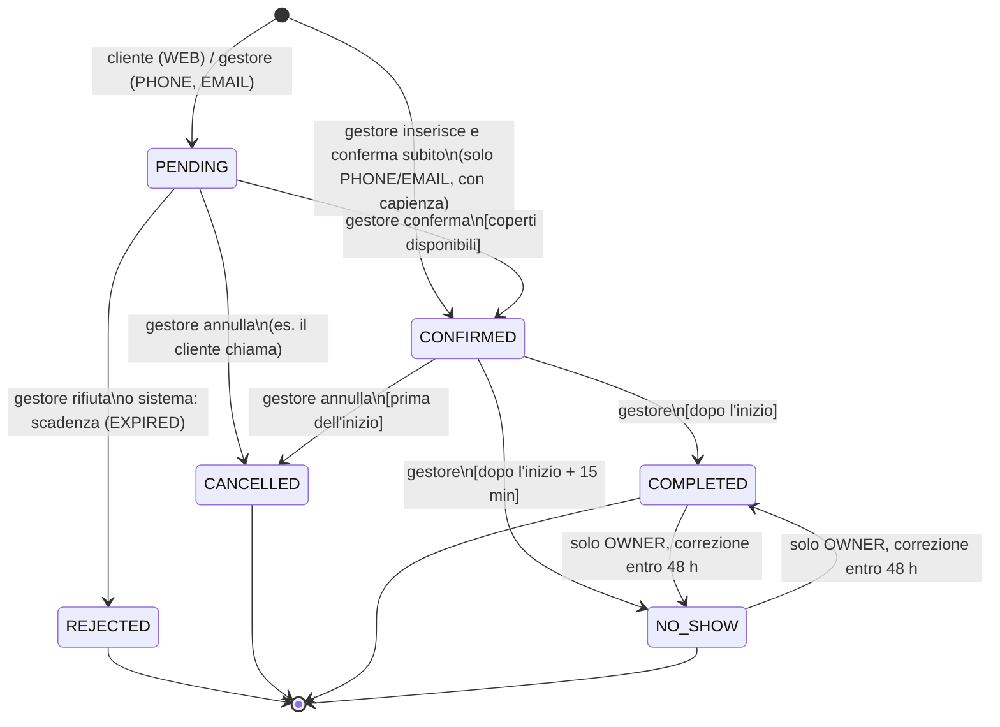

# Regole di prenotazione e capienza — V1

> FASE 1 · 19/10/2026 · Stato: **proposta da approvare**. Le voci marcate **(P-nn)** sono proposte che richiedono il tuo OK (elenco in DECISION_LOG §3).
> Principio V1: **il cliente chiede, il gestore decide.** Nessuna conferma automatica, nessuna assegnazione automatica di tavoli.

## 1. Concetti

| Termine | Significato |
|---|---|
| **Orari pubblici** | quando il locale è aperto (mostrati sul sito). Non decidono le prenotazioni. |
| **Fascia prenotabile** (`service_window`) | intervallo di un giorno della settimana in cui si accettano richieste: primo e ultimo orario di arrivo, passo (15/30/60 min), durata standard, **capienza in coperti** decisa dal gestore. Es. «Aperitivo, ven, 18:00–20:30, ogni 30 min, 120 min, 40 coperti». |
| **Contatore** (`capacity_bucket`) | coperti già **confermati** per una fascia in una data, o per un evento. |
| **Richiesta** | prenotazione in stato `PENDING`: non consuma coperti. |
| **Eccezione** | per una data: fascia chiusa o capienza diversa (es. 0 = chiuso, ferie, evento privato). |
| **Regole generali** (`booking_policy`) | anticipo minimo, giorni massimi in avanti, persone massime dal web, scadenza delle richieste, web on/off. Modalità di conferma: **sempre `MANUAL`** in V1. |

Valori iniziali **di esempio** (da sostituire con quelli dei titolari, D-03): anticipo minimo 60 min, prenotabile fino a 60 giorni, massimo 12 persone dal web, scadenza 60 min prima dell'arrivo. Finché i titolari non configurano fasce reali, **le prenotazioni web restano disattivate** (`web_booking_enabled = false`).

## 2. State machine



### Tabella delle transizioni

| Da → A | Chi | Precondizioni | Effetti nella **stessa transazione** |
|---|---|---|---|
| — → PENDING | pubblico (WEB), STAFF/OWNER (PHONE/EMAIL) | validazioni §4; WEB: regole web §5 | crea riga + storico; outbox: email al locale (WEB) e «richiesta ricevuta» al cliente se email presente |
| — → CONFIRMED | STAFF/OWNER, solo PHONE/EMAIL con `confirmNow` | come sotto | come PENDING→CONFIRMED |
| PENDING → CONFIRMED | STAFF/OWNER | `version` corrispondente; inizio nel futuro; consumo coperti riuscito (§3) | `confirmed_covers += guest_count`; `capacity_bucket_id`; `confirmed_at`; assegnazione tavoli facoltativa nella stessa richiesta (§8); storico; audit; outbox conferma al cliente |
| PENDING → REJECTED | STAFF/OWNER; sistema | motivo obbligatorio | storico; outbox «non possiamo confermare» se il cliente ha un recapito utilizzabile |
| PENDING → CANCELLED | STAFF/OWNER | motivo `CUSTOMER_REQUEST` o `VENUE_DECISION` | storico; nessun messaggio se richiesto dal cliente (P-11) |
| CONFIRMED → CANCELLED | STAFF/OWNER | prima di `starts_at` | `confirmed_covers -= guest_count`; assegnazioni `active = false`; storico; outbox «annullata» al cliente |
| CONFIRMED → COMPLETED | STAFF/OWNER | `now ≥ starts_at` | storico (coperti restano consumati) |
| CONFIRMED → NO_SHOW | STAFF/OWNER | `now ≥ starts_at + 15 min` | storico; assegnazioni `active = false` |
| NO_SHOW ↔ COMPLETED | solo OWNER | entro 48 h | storico con nota obbligatoria |

**Idempotenza delle transizioni**: richiedere lo stato in cui la prenotazione è già (es. doppio clic su «Conferma») restituisce `200` con la prenotazione invariata, **senza** nuovo storico né nuova notifica. Qualsiasi transizione non in tabella → `409 INVALID_TRANSITION`. Il client non può mai creare direttamente una prenotazione `CONFIRMED` dall'API pubblica.

**Lock ottimistico**: ogni comando del gestore porta la `version` letta; se nel frattempo un altro gestore ha modificato la prenotazione → `409 VERSION_CONFLICT` e la UI ricarica.

## 3. Capienza: regole e controllo atomico

1. Ogni prenotazione ordinaria appartiene a **una** fascia (quella che contiene l'orario di arrivo) e consuma coperti **solo** sul contatore di quella fascia in quella data. Ogni prenotazione per evento consuma sul contatore dell'evento.
2. Capienza vigente per fascia-giorno = eccezione del giorno se esiste (0 se `CLOSED`), altrimenti `service_windows.capacity_covers`.
3. **Le richieste `PENDING` non consumano capienza** (master plan). La dashboard mostra comunque: capienza, confermati, coperti in attesa, residui.
4. Consumo atomico — un'unica istruzione, nessun `COUNT(*)` concorrente:
   ```sql
   UPDATE capacity_buckets
      SET confirmed_covers = confirmed_covers + :n, updated_at = now()
    WHERE id = :bucket AND confirmed_covers + :n <= capacity_covers
   RETURNING confirmed_covers;
   ```
   0 righe → `409 CAPACITY_EXCEEDED` (con capienza e residui nel corpo dell'errore) e **nessuna modifica**. PostgreSQL serializza gli update sulla stessa riga: verificato con 20 conferme parallele da 2 coperti su capienza 10 → **esattamente 5** riuscite, contatore = 10 (spike).
5. Rilascio: `confirmed_covers = confirmed_covers - :n` (mai sotto 0, `CHECK`).
6. **Il gestore cambia la capienza**: la nuova capienza vale per i contatori futuri. Se una data ha già più confermati della nuova capienza → `409 CAPACITY_BELOW_CONFIRMED` con l'elenco delle date in conflitto; **nessuna prenotazione viene annullata automaticamente**. Il gestore decide (annulla manualmente o sceglie un valore più alto).
7. **Più contatori nella stessa transazione** (es. spostamento di data): si aggiornano in ordine di `id` crescente per evitare deadlock.
8. **Override del gestore** (P-25): nessuno in V1. Se serve aggiungere 2 persone in più, il gestore alza la capienza di quella data (eccezione `CAPACITY_OVERRIDE`) e l'azione resta nell'audit.

## 4. Data, ora e fuso

- Il cliente sceglie **data locale + orario di arrivo** tra gli slot proposti (`GET /public/booking-options`). Il server ricalcola tutto: non si fida degli slot inviati.
- Conversione con `ZoneId.of("Europe/Rome")`: `starts_at = data + ora` locale → `timestamptz`; `ends_at = starts_at + default_duration_minutes` della fascia (o fine evento).
- **Cambio d'ora**: un orario inesistente (es. 29/03/2026 02:30) è **rifiutato** con `422` — PostgreSQL lo sposterebbe silenziosamente alle 03:30 (verificato nello spike), quindi il controllo è in Java con `ZoneRules.getValidOffsets`. Un orario ambiguo (25/10/2026 02:30) usa l'offset estivo (il primo). In pratica le fasce del locale non toccano quelle ore.
- `reservation_date` è sempre la data **locale** dell'arrivo.
- Validazioni comuni: arrivo ≥ adesso + anticipo minimo; data ≤ oggi + giorni massimi; arrivo allineato al passo della fascia e tra primo e ultimo orario; persone 1–50 (web: fino al massimo configurato, oltre → messaggio «per gruppi più grandi chiamaci»).
- Il gestore (PHONE/EMAIL) può inserire anche orari fuori dagli slot o con anticipo minore: riceve un **avviso**, non un blocco. La capienza resta comunque vincolante.

## 5. Richieste dal sito (WEB)

Accettata solo se: web attivo; fascia attiva e non chiusa da eccezione; nessun evento «bloccante» sovrapposto (§7); dati validi; informativa privacy accettata; **coperti residui confermati ≥ persone richieste** (P-04: se la fascia è già piena di confermati, il sito risponde «completo, chiamaci» invece di creare richieste destinate al rifiuto).

Anti-abuso:
- header **`Idempotency-Key`** obbligatorio (UUID generato dal browser all'apertura del riepilogo); stesso key + stessi dati → stessa risposta; stesso key + dati diversi → `422 IDEMPOTENCY_KEY_REUSED`;
- duplicato **stesso telefono + stesso orario** ancora attivo → `409 DUPLICATE_REQUEST` (vincolo `ux_res_web_duplicate`);
- limite di frequenza: 5 richieste/ora per IP e 3/giorno per numero di telefono → `429` con `Retry-After` (P-21);
- campo trappola invisibile (honeypot): se compilato, risposta generica senza salvare;
- niente CAPTCHA a puzzle (accessibilità), eventualmente Cloudflare Turnstile in FASE 8.

Dati raccolti (minimi): nome, **telefono obbligatorio** (E.164; numeri italiani normalizzati), email facoltativa, note (≤ 500, con avviso «non inserire dati sanitari»), presa visione informativa con versione. (P-10)

## 6. Scadenza, annullamento e modifica

### Scadenza delle richieste
- Una richiesta `PENDING` non gestita entro **`starts_at − pending_expiry_minutes_before_start`** (esempio: 60 min prima) passa a `REJECTED` con motivo **`EXPIRED`** tramite job ogni 5 minuti (P-05).
- Il job usa un update condizionale (`WHERE id = :id AND status = 'PENDING'`), quindi non entra mai in conflitto con una conferma concorrente: vince chi arriva prima, l'altro riceve `409`.
- Se il cliente ha un recapito utilizzabile, riceve «non siamo riusciti a confermare in tempo, chiamaci».
- La dashboard evidenzia le richieste che scadono entro 2 ore.

### Annullamento
- **V1: solo il gestore** annulla (anche su richiesta del cliente arrivata per telefono/email/Instagram). Nessun link di auto-annullamento per il cliente (P-09; possibile V1.1 con link firmato monouso).
- Annullare una confermata rilascia i coperti e disattiva le assegnazioni tavoli nella stessa transazione.
- Non si annulla dopo l'inizio: si usa `NO_SHOW` o `COMPLETED`.

### Modifica
- **PENDING**: il gestore può cambiare data, ora, persone, note liberamente (nessun coperto coinvolto); validazioni §4.
- **CONFIRMED**: modifica atomica in un'unica transazione:
  1. persone in più nella stessa fascia → consumo condizionale del solo **delta**;
  2. persone in meno → rilascio del delta;
  3. cambio di data/fascia → rilascio dal vecchio contatore + consumo sul nuovo (ordine per `id`);
  4. cambio d'orario con tavoli assegnati → aggiornamento degli intervalli `occupied`; se il tavolo è occupato nel nuovo intervallo → `409 TABLE_CONFLICT` e **niente cambia**.
- Ogni modifica di una confermata produce storico + audit + notifica «prenotazione aggiornata» (`business_event_key` include la `version`, così ogni modifica notifica una sola volta).
- Il cliente non modifica da solo in V1.

## 7. Eventi e conflitti con il servizio ordinario

1. Un evento prenotabile ha `booking_mode = REQUEST`, inizio, fine e **capienza in coperti** decisa dal gestore; ha il **suo** contatore. Area: tutto il locale (default) o un'area (P-06, P-07).
2. Le richieste per l'evento seguono la stessa state machine (PENDING → conferma manuale entro i posti residui dell'evento).
3. **Blocco del servizio ordinario** (`blocks_ordinary_booking = true`, default): durante l'intervallo dell'evento il sito **non accetta** richieste ordinarie che si sovrappongono, nella stessa area o in tutto il locale; il cliente viene indirizzato all'evento. Il gestore può comunque inserire manualmente una prenotazione ordinaria, con avviso.
4. **Pubblicare o spostare un evento** che si sovrappone a prenotazioni ordinarie `PENDING`/`CONFIRMED`: l'API risponde `409 EVENT_CONFLICTS` con l'elenco (riferimento, ora, persone, stato, **senza** dati personali). Il gestore può:
   - confermare la pubblicazione «sapendo dei conflitti» (`acknowledgeConflicts: true`) → le prenotazioni restano valide;
   - oppure gestirle una per una (annullare, spostare).
   **Nessuna prenotazione viene annullata o spostata automaticamente.**
5. **Ridurre la capienza** di un evento sotto i confermati → `409 CAPACITY_BELOW_CONFIRMED`.
6. **Annullare un evento** con prenotazioni attive: richiede scelta esplicita `cancelReservations: true|false`. Con `true`, ogni prenotazione passa a `CANCELLED` motivo `EVENT_CANCELLED` (con notifica), tutto in una transazione; con `false`, l'evento viene annullato e le prenotazioni restano da gestire (la dashboard le evidenzia).
7. Se `blocks_ordinary_booking = false` (es. DJ set su un'area mentre il resto del locale lavora normalmente), i due contatori sono indipendenti: il gestore deve aver impostato le capienze in modo che la somma sia sostenibile. Nessun calcolo automatico in V1.

## 8. Tavoli (manuale e facoltativo)

- Aree e tavoli li configura l'OWNER (codice, area, posti min/max). Possono anche non esistere: la V1 funziona solo con i coperti.
- Il gestore **può** assegnare uno o più tavoli a una prenotazione **CONFIRMED** (anche nella stessa richiesta di conferma). Mai automaticamente.
- Intervallo occupato = `[starts_at, ends_at)` della prenotazione. Tavoli adiacenti nel tempo (uno finisce 21:30, l'altro inizia 21:30) sono ammessi.
- Conflitto → `409 TABLE_CONFLICT` con il riferimento della prenotazione che occupa il tavolo (garantito dal vincolo di esclusione anche con due gestori in contemporanea).
- Persone > somma dei posti massimi dei tavoli assegnati → **avviso** nella risposta (`warnings: ["SEATS_BELOW_PARTY_SIZE"]`), non blocco (P-08).
- Annullamento, `NO_SHOW` o cambio d'orario aggiornano le assegnazioni nella stessa transazione.
- Sostituzione dei tavoli: `PUT …/tables` con l'elenco completo; le vecchie assegnazioni diventano `active = false` (storico conservato).

## 9. Notifiche collegate alle prenotazioni (P-11)

| Fatto | Locale (email) | Cliente email | Cliente SMS |
|---|---|---|---|
| Nuova richiesta WEB | ✓ | «richiesta ricevuta» se email presente | — |
| Confermata | — | ✓ se email | **Fake in V1**; reale solo dopo approvazione costi e provider |
| Rifiutata / scaduta | — | ✓ se email | Fake |
| Annullata dal locale | — | ✓ se email | Fake |
| Modificata (confermata) | — | ✓ se email | Fake |

Tutte passano dall'**outbox**: accodate nella stessa transazione del cambio di stato, inviate dal worker dopo il commit, con chiave unica anti-duplicato. Un invio fallito non cambia la prenotazione; la riga in dashboard mostra lo stato del messaggio (`In coda / Inviato / Non inviato / Non previsto`).

## 10. Ruoli e permessi

| Operazione | OWNER | STAFF | Pubblico |
|---|:-:|:-:|:-:|
| Vedere opzioni prenotabili, inviare richiesta | | | ✓ |
| Vedere elenco e dettaglio prenotazioni | ✓ | ✓ | |
| Inserire prenotazione PHONE/EMAIL | ✓ | ✓ | |
| Confermare / rifiutare / annullare / completare / no-show | ✓ | ✓ | |
| Correggere NO_SHOW ↔ COMPLETED | ✓ | | |
| Assegnare tavoli | ✓ | ✓ | |
| Fasce, capienze, eccezioni, regole generali, aree, tavoli | ✓ | | |
| Creare/pubblicare eventi e capienza evento | ✓ | ✓ | |
| Annullare un evento con prenotazioni | ✓ | | |
| Template notifiche, attivazione SMS | ✓ | | |
| Rinviare una notifica fallita | ✓ | ✓ | |
| Menu, foto, avvisi | ✓ | ✓ | |
| Personalizza sito, impostazioni, utenti | ✓ | | |

Ogni controllo è **lato server** (regole su URL + `@PreAuthorize` sui servizi). Un id inesistente o non visibile risponde `404` senza rivelare altro.

## 11. Privacy (sintesi)

- Dati minimi; note libere mai nei log né nell'outbox.
- Log applicativi: solo `public_ref` e id, mai nome/telefono/email.
- Anonimizzazione automatica dopo N giorni dalla data (proposta 90, P-13): nome → «—», telefono/email → null, note → null; i numeri aggregati restano.
- Testi informativi da validare con un esperto (FASE 8).

## 12. Cosa NON fa la V1

Auto-conferma; scelta automatica o combinazione di tavoli; suggerimento di orari alternativi; lista d'attesa; overbooking controllato; durata variabile per gruppo; lettura automatica di email/telefonate; area clienti con login; pagamenti/caparre. Ogni punto richiede una nuova approvazione (V2).
