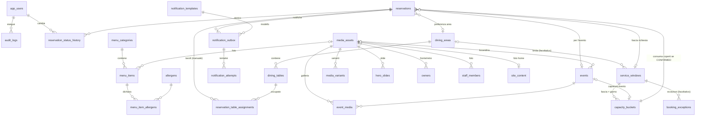
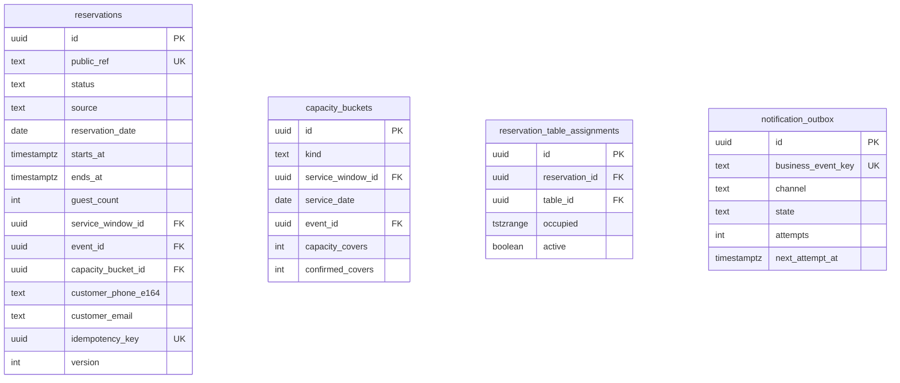

# Modello dati PostgreSQL — FireFlies Aperitif V1

> FASE 1 · 19/10/2026 · Stato: **proposta da approvare**. Questo documento **non è una migrazione**: lo schema Flyway `V1__…` sarà scritto da zero in FASE 2 a partire da qui.
> La bozza SQL precedente (`V1__initial_schema.sql`) non è disponibile (vedi DECISION_LOG §4): nessun elemento di `AUTO_TABLE` o di assegnazione automatica è stato ripreso.

## 1. Convenzioni

| Tema | Regola |
|---|---|
| Nomi | `snake_case`, tabelle al plurale, vincoli con prefisso: `pk_`, `fk_`, `uq_`/`ux_`, `ck_`, `ex_`, indici `ix_` |
| Chiavi | `uuid` generati con `gen_random_uuid()` per le entità esposte via API; `bigint generated always as identity` per tabelle solo interne (storico, audit, tentativi); codice testuale per i dati di riferimento (allergeni) |
| Tempo | istanti in `timestamptz` (UTC in DB); date locali in `date`; orari di calendario in `time` interpretati in **Europe/Rome**; intervalli `[inizio, fine)` |
| Denaro | `price_cents integer` (euro × 100), `NULL` = prezzo non comunicato |
| Enum | `text` + `CHECK (… IN (…))` (più semplice da evolvere di `CREATE TYPE`) |
| Audit colonne | `created_at`, `updated_at` (`timestamptz not null default now()`), `version integer` per lock ottimistico dove c'è modifica concorrente da UI |
| Cancellazioni | fisiche per configurazione; **mai** per prenotazioni (si cambia stato) né per media in uso (FK `RESTRICT`) |
| Estensioni | solo `btree_gist` (per il vincolo di esclusione sui tavoli) |
| Dati seed | solo dati di riferimento normativi (14 allergeni UE) e template notifiche; dati demo **solo** nel profilo `local`, etichettati |

## 2. Diagramma ER

Colonne principali (tipi e vincoli completi nelle sezioni seguenti):

## 3. Tabelle, vincoli e indici

### 3.1 Identità e audit (modulo `security`, `audit`)

**`app_users`**
| Colonna | Tipo | Vincoli |
|---|---|---|
| id | uuid | PK |
| email | varchar(254) | not null; `ux_app_users_email` UNIQUE su `lower(email)` |
| password_hash | varchar(255) | not null (bcrypt/Argon2, mai in chiaro) |
| display_name | varchar(80) | not null |
| role | text | not null, `CHECK (role IN ('OWNER','STAFF'))` |
| active | boolean | not null default true |
| failed_login_count | int | not null default 0, `CHECK (>= 0)` |
| locked_until | timestamptz | null |
| last_login_at, password_changed_at | timestamptz | null |
| created_at, updated_at, version | | |

Un utente ha **un solo ruolo** (OWNER include tutti i permessi di STAFF): più semplice di `app_roles` + `app_user_roles`, sufficiente per la V1. Nessun account creato dalle migrazioni: il primo OWNER si crea con un comando una tantum (FASE 3).

**`spring_session`, `spring_session_attributes`**: schema ufficiale Spring Session JDBC, copiato nella migrazione Flyway (non auto-generato). Indici su `expiry_time` e `principal_name` come da schema ufficiale.

**`audit_logs`**: `id bigint identity PK`, `actor_user_id uuid null FK → app_users ON DELETE SET NULL` (null = sistema), `action text not null` (es. `RESERVATION_CONFIRMED`), `object_type text not null`, `object_id text not null`, `metadata jsonb not null default '{}'` (**senza dati personali**: niente nomi/telefoni), `occurred_at timestamptz not null`.
Indici: `ix_audit_object (object_type, object_id, occurred_at desc)`, `ix_audit_occurred (occurred_at)`.

### 3.2 Spazi, fasce e regole (modulo `dining`)

**`dining_areas`**: `id uuid PK`, `name varchar(60) not null` (`ux_dining_areas_name` su `lower(name)`), `active boolean`, `sort_order int`.

**`dining_tables`**
| Colonna | Vincoli |
|---|---|
| id uuid | PK |
| area_id uuid | not null, FK → dining_areas `RESTRICT` |
| code varchar(10) | not null; `uq_table_code UNIQUE (area_id, code)` |
| min_seats, max_seats smallint | `CHECK (min_seats >= 1 AND max_seats >= min_seats AND max_seats <= 30)` |
| active boolean, sort_order int | |

Nessuna colonna `combinable`: la combinazione di tavoli è **V2**. I posti sono scritti dal gestore e servono come informazione/avviso, non per calcoli automatici.

**`service_windows`** (fasce prenotabili, distinte dagli orari pubblici)
| Colonna | Vincoli |
|---|---|
| id uuid | PK |
| area_id uuid | null = tutto il locale; FK → dining_areas |
| iso_day smallint | `CHECK (iso_day BETWEEN 1 AND 7)` (1 = lunedì) |
| name varchar(40) | es. «Aperitivo» |
| first_start, last_start time | `CHECK (last_start >= first_start)`; niente fasce oltre la mezzanotte in V1 |
| slot_minutes smallint | `CHECK (slot_minutes IN (15, 30, 60))` |
| default_duration_minutes smallint | `CHECK (BETWEEN 30 AND 360)` |
| capacity_covers int | `CHECK (>= 0)` |
| valid_from date not null, valid_to date null | `CHECK (valid_to IS NULL OR valid_to >= valid_from)` |
| active boolean | |

Sovrapposizioni tra fasce dello stesso giorno/area: rifiutate dall'applicazione (validazione in un'unica transazione con lock sulle fasce del giorno). Indice `ix_windows_day (iso_day, active)`.

**`booking_policies`** (regole generali, con data di validità)
| Colonna | Vincoli |
|---|---|
| id uuid | PK |
| effective_from date | not null, UNIQUE |
| confirmation_mode text | `CHECK (confirmation_mode = 'MANUAL')` — **in V1 l'unico valore ammesso**; l'auto-conferma richiederà una nuova migrazione e una nuova approvazione |
| web_booking_enabled boolean | |
| min_lead_minutes int | `CHECK (BETWEEN 0 AND 10080)` |
| max_advance_days int | `CHECK (BETWEEN 1 AND 365)` |
| max_party_size_web smallint | `CHECK (BETWEEN 1 AND 50)` |
| pending_expiry_minutes_before_start int | `CHECK (BETWEEN 0 AND 1440)` |
| created_by uuid, created_at | |

Regola vigente = riga con `effective_from` più recente ≤ data della prenotazione.

**`booking_exceptions`**
| Colonna | Vincoli |
|---|---|
| id uuid | PK |
| service_date date | not null |
| service_window_id uuid | null = tutte le fasce del giorno; FK → service_windows `CASCADE` |
| kind text | `CHECK (kind IN ('CLOSED','CAPACITY_OVERRIDE'))` |
| capacity_override int | `CHECK ((kind = 'CAPACITY_OVERRIDE') = (capacity_override IS NOT NULL))`, `>= 0` |
| reason varchar(140), created_by, created_at | |

`ux_booking_exception UNIQUE NULLS NOT DISTINCT (service_date, service_window_id)` (PostgreSQL ≥ 15).

### 3.3 Capienza (modulo `capacity`)

**`capacity_buckets`** — un contatore per «fascia × giorno» oppure per «evento».

| Colonna | Vincoli |
|---|---|
| id uuid | PK |
| kind text | `CHECK (kind IN ('SERVICE','EVENT'))` |
| service_window_id uuid, service_date date | valorizzati se `SERVICE` |
| event_id uuid | valorizzato se `EVENT`, FK → events `RESTRICT` |
| capacity_covers int | `CHECK (>= 0)` |
| confirmed_covers int | `CHECK (>= 0)` |
| updated_at | |

- `ck_bucket_kind`: `(kind='SERVICE' AND service_window_id IS NOT NULL AND service_date IS NOT NULL AND event_id IS NULL) OR (kind='EVENT' AND event_id IS NOT NULL AND service_window_id IS NULL AND service_date IS NULL)`.
- **`ck_bucket_not_overbooked`: `CHECK (confirmed_covers <= capacity_covers)`** — ultima difesa: nessun codice può superare la capienza, nemmeno abbassandola sotto i confermati (verificato nello spike).
- `ux_bucket_service UNIQUE (service_window_id, service_date)`, `ux_bucket_event UNIQUE (event_id)`.

Creazione **pigra**: alla prima conferma per una fascia-giorno si esegue `INSERT … ON CONFLICT DO NOTHING` copiando la capienza vigente (fascia o eccezione), poi l'update condizionale. Le modifiche di capienza del gestore aggiornano anche i contatori futuri già creati, nella stessa transazione.

### 3.4 Prenotazioni (modulo `reservation`)

**`reservations`**
| Colonna | Tipo | Vincoli / note |
|---|---|---|
| id | uuid | PK |
| public_ref | varchar(12) | not null UNIQUE; codice leggibile casuale (es. `FF-7K3Q9M`) da comunicare al telefono |
| status | text | `CHECK (status IN ('PENDING','CONFIRMED','REJECTED','CANCELLED','COMPLETED','NO_SHOW'))` |
| status_reason | text | null; `CHECK (IN ('EXPIRED','NO_CAPACITY','CUSTOMER_REQUEST','VENUE_DECISION','EVENT_CANCELLED','DUPLICATE','OTHER'))` |
| source | text | `CHECK (source IN ('WEB','PHONE','EMAIL'))` |
| reservation_date | date | data locale del servizio (Europe/Rome) |
| starts_at, ends_at | timestamptz | `CHECK (ends_at > starts_at)` |
| guest_count | smallint | `CHECK (guest_count BETWEEN 1 AND 50)` |
| service_window_id | uuid null | FK → service_windows `RESTRICT`; obbligatorio se `event_id IS NULL` |
| event_id | uuid null | FK → events `RESTRICT` |
| area_id | uuid null | FK → dining_areas; preferenza, non assegnazione |
| capacity_bucket_id | uuid null | FK → capacity_buckets `RESTRICT` |
| customer_name | varchar(80) | not null (salvo anonimizzazione) |
| customer_phone_e164 | varchar(16) | `CHECK (customer_phone_e164 ~ '^\+[1-9][0-9]{6,14}$')`; not null salvo anonimizzazione (P-10) |
| customer_email | varchar(254) | null |
| customer_notes | varchar(500) | null |
| internal_note | varchar(500) | null, visibile solo ai gestori |
| needs_callback | boolean | not null default false (ex stato «da contattare» del mockup) |
| privacy_notice_version | varchar(20) | not null per `WEB` |
| privacy_ack_at | timestamptz | not null per `WEB` |
| idempotency_key | uuid null | `ux_res_idem UNIQUE (idempotency_key)` |
| request_fingerprint | char(64) null | SHA-256 del payload normalizzato, per rilevare riuso della chiave con dati diversi |
| created_by_user_id, handled_by_user_id | uuid null | FK → app_users `SET NULL` |
| confirmed_at, closed_at, anonymized_at | timestamptz null | |
| created_at, updated_at, version | | |

Vincoli di coerenza:
- `ck_res_target`: `(event_id IS NOT NULL) OR (service_window_id IS NOT NULL)`.
- **`ck_res_confirmed_has_bucket`: `status NOT IN ('CONFIRMED','COMPLETED','NO_SHOW') OR capacity_bucket_id IS NOT NULL`** — una prenotazione confermata ha sempre consumato coperti.
- `ck_res_web_privacy`: `source <> 'WEB' OR (privacy_ack_at IS NOT NULL AND privacy_notice_version IS NOT NULL)`.
- `ck_res_anonymized`: `anonymized_at IS NOT NULL OR (customer_phone_e164 IS NOT NULL AND customer_name IS NOT NULL)`.
- **`ux_res_web_duplicate`: `UNIQUE (customer_phone_e164, starts_at) WHERE source = 'WEB' AND status IN ('PENDING','CONFIRMED')`** — blocca il doppio invio dallo stesso telefono per lo stesso orario anche senza chiave di idempotenza; non vale per gli inserimenti dei gestori (verificato nello spike).

Indici:
- `ix_res_date_status (reservation_date, status)` — dashboard giornaliera.
- `ix_res_pending_start (starts_at) WHERE status = 'PENDING'` — job di scadenza e coda «da gestire».
- `ix_res_event (event_id, status) WHERE event_id IS NOT NULL`.
- `ix_res_bucket (capacity_bucket_id) WHERE capacity_bucket_id IS NOT NULL`.
- `ix_res_phone (customer_phone_e164)` — ricerca dal telefono.
- `ix_res_created (created_at desc)`.

**`reservation_table_assignments`** (assegnazione manuale e facoltativa)
| Colonna | Vincoli |
|---|---|
| id uuid | PK |
| reservation_id uuid | not null FK → reservations `RESTRICT` |
| table_id uuid | not null FK → dining_tables `RESTRICT` |
| occupied tstzrange | not null, `CHECK (lower_inc(occupied) AND NOT upper_inc(occupied) AND NOT isempty(occupied))` → sempre `[inizio, fine)` |
| active boolean | not null default true |
| assigned_by uuid, assigned_at, released_at | |

- **`ex_table_no_overlap EXCLUDE USING gist (table_id WITH =, occupied WITH &&) WHERE (active)`** — due assegnazioni attive dello stesso tavolo non possono sovrapporsi; intervalli adiacenti (`21:30` fine / `21:30` inizio) sono ammessi (verificato nello spike).
- `ux_assignment_once UNIQUE (reservation_id, table_id) WHERE active`.
- `ix_assign_res (reservation_id)`.

Il predicato non può leggere lo stato della prenotazione (sta in un'altra tabella): per questo c'è la colonna **`active`**, aggiornata **nella stessa transazione** di ogni cambio di stato o di orario (BOOKING_RULES §8).

**`reservation_status_history`**: `id bigint identity PK`, `reservation_id uuid not null FK`, `from_status text null`, `to_status text not null`, `reason text null`, `note varchar(300) null`, `changed_by_user_id uuid null` (null = cliente web o sistema), `changed_at timestamptz not null`. Indice `(reservation_id, changed_at)`. Anche le **modifiche** (data, ora, persone) vengono registrate qui con `from_status = to_status` e `note` sintetica senza dati personali.

### 3.5 Eventi (modulo `event`)

**`events`**
| Colonna | Vincoli |
|---|---|
| id uuid | PK |
| slug varchar(80) | not null UNIQUE, `CHECK (slug ~ '^[a-z0-9]+(-[a-z0-9]+)*$')` |
| title varchar(120), kind text | `CHECK (kind IN ('SERATA','FORMAT'))` |
| status text | `CHECK (status IN ('DRAFT','PUBLISHED','CANCELLED'))` |
| starts_at, ends_at | timestamptz null; `CHECK (ends_at IS NULL OR starts_at IS NULL OR ends_at > starts_at)` |
| area_id | null = tutto il locale |
| artist, summary, body | varchar/text con lunghezze massime |
| poster_media_id | FK → media_assets `RESTRICT` |
| booking_mode text | `CHECK (booking_mode IN ('NONE','REQUEST'))` |
| capacity_covers int | null |
| blocks_ordinary_booking boolean | not null default true |
| created/updated, version | |

- `ck_event_published_has_date`: `status <> 'PUBLISHED' OR kind = 'FORMAT' OR starts_at IS NOT NULL`.
- `ck_event_booking_complete`: `booking_mode = 'NONE' OR (starts_at IS NOT NULL AND ends_at IS NOT NULL AND capacity_covers IS NOT NULL AND capacity_covers >= 0)`.
- Indici: `ix_events_public (status, starts_at)`, `ix_events_range` GiST su `tstzrange(starts_at, ends_at)` per la ricerca dei conflitti.

**`event_media`**: `(event_id, media_id)` PK, `sort_order`; FK `RESTRICT` su media.

### 3.6 Menu (modulo `menu`)

- **`menu_categories`**: `id uuid PK`, `slug UNIQUE`, `name varchar(40)`, `hint varchar(80)`, `sort_order`, `visible`.
- **`menu_items`**: `id uuid PK`, `category_id FK RESTRICT`, `name varchar(80)`, `description varchar(400)`, `ingredients varchar(400) null`, **`price_cents int null CHECK (price_cents >= 0 AND price_cents <= 100000)`**, `photo_media_id FK RESTRICT null`, `allergens_status text CHECK (IN ('UNDECLARED','DECLARED'))`, `allergens_verified_at`, `allergens_verified_by`, `visible`, `sort_order`, `version`, timestamp. Indice `(category_id, sort_order)`.
  - `allergens_status` distingue «nessun allergene» (dichiarato, elenco vuoto) da «non ancora dichiarato» — distinzione già presente nel mockup (`null` vs `[]`).
  - `ck_item_allergens_verified`: `allergens_status = 'UNDECLARED' OR allergens_verified_at IS NOT NULL`.
- **`allergens`**: `code text PK` (14 allergeni del Reg. UE 1169/2011, Allegato II), `name_it`, `sort_order`. Seed nella migrazione (dato normativo, non demo).
- **`menu_item_allergens`**: PK `(menu_item_id, allergen_code)`, FK `CASCADE` sulla voce.

### 3.7 Media e contenuti (moduli `media`, `content`)

**`media_assets`**
| Colonna | Vincoli |
|---|---|
| id uuid | PK |
| storage_key varchar(200) | UNIQUE; nome casuale (`media/{uuid}/original`), mai il nome file dell'utente |
| status text | `CHECK (status IN ('PENDING_UPLOAD','PROCESSING','READY','REJECTED'))` |
| mime_type text | `CHECK (mime_type IN ('image/jpeg','image/png','image/webp'))` |
| bytes int | `CHECK (bytes BETWEEN 1 AND 5242880)` (5 MB come nel mockup) |
| width, height int | `> 0` quando READY |
| sha256 char(64) | null fino alla verifica |
| alt_text varchar(250) | `CHECK (status <> 'READY' OR alt_text IS NOT NULL)` |
| credit, consent_note varchar | |
| in_gallery boolean, gallery_order int | |
| uploaded_by, created_at, ready_at, upload_expires_at | |

Indici: `ix_media_gallery (gallery_order) WHERE in_gallery AND status = 'READY'`, `ix_media_pending (upload_expires_at) WHERE status = 'PENDING_UPLOAD'`.

**`media_variants`**: `(media_id, variant)` UNIQUE, `variant CHECK (IN ('W480','W960','W1600'))`, `storage_key UNIQUE`, `width`, `height`, `bytes`; FK `CASCADE`.

**Uso dei media**: niente tabella generica senza FK. Ogni riferimento è una **FK reale con `ON DELETE RESTRICT`** (`menu_items.photo_media_id`, `events.poster_media_id`, `event_media`, `hero_slides`, `owners.front_media_id/back_media_id`, `staff_members.media_id`, `site_content.hero_media_id`): il database impedisce di cancellare una foto in uso (→ API `409 MEDIA_IN_USE`). Una vista `media_usages_v` (UNION delle FK) alimenta il messaggio «è usata in…» già presente nel mockup.

**Contenuti**
- `site_settings` (riga unica, `id smallint PK CHECK (id = 1)`): indirizzo, `map_query`, `map_mode CHECK (IN ('CONSENT','AUTO'))`, telefono ed email pubblici, Instagram, `address_confirmed`, `hours_confirmed`, `menu_hero_interval_sec CHECK (BETWEEN 10 AND 600) DEFAULT 60`, `version`.
- `site_content` (riga unica): `hero_claim`, `hero_lead`, `hero_media_id`, `story_title`, `story_text`, `story_confirmed`, `version`.
- `site_sections`: `code text PK`, `enabled`, `sort_order`.
- `opening_hours`: `id`, `iso_day`, `opens_at`, `closes_at`, `closed`; `CHECK (closed OR closes_at > opens_at)` (gestione chiusura dopo mezzanotte: `closes_at` può essere `00:00`–`04:00` del giorno dopo con flag `closes_next_day` — P-24). Orari **pubblici**, non usati per accettare prenotazioni.
- `opening_exceptions`: `date UNIQUE`, `closed`, orari alternativi, nota.
- `hero_slides`: `id`, `page CHECK (IN ('MENU','HOME'))`, `media_id FK RESTRICT`, `sort_order`, `enabled`; `UNIQUE (page, sort_order) DEFERRABLE INITIALLY DEFERRED` (riordino in una transazione).
- `owners`: nome, ruolo, descrizione, motto, `front_media_id`, `back_media_id`, `color_token CHECK (IN ('giallo','arancione','verde', …))`, `sort_order`, `visible`.
- `staff_members`: nome, ruolo, `media_id`, ordine, visibile.
- `announcements`: `text varchar(140)`, `tone CHECK (IN ('INFO','IMPORTANT'))`, `active`, `visible_until timestamptz null`, autore. Indice `(active, visible_until)`.

### 3.8 Notifiche (modulo `notification`)

**`notification_templates`**: PK `(code, channel)`, `channel CHECK (IN ('EMAIL','SMS'))`, `subject null`, `body text`, `active`, `version`. `CHECK (channel <> 'SMS' OR char_length(body) <= 320)`.

**`notification_outbox`**
| Colonna | Vincoli |
|---|---|
| id uuid | PK |
| business_event_key varchar(160) | **UNIQUE** — es. `reservation:{id}:CONFIRMED:CUSTOMER:EMAIL`; impedisce doppie notifiche |
| aggregate_type text, aggregate_id uuid | es. `RESERVATION`, id |
| channel text | `EMAIL` / `SMS` |
| recipient_kind text | `CHECK (IN ('CUSTOMER','STAFF'))` |
| recipient varchar(254) | telefono E.164 o email; cancellato alla pulizia |
| template_code text | FK → template |
| payload jsonb | minimo: data, ora, persone, riferimento, nome del locale; **mai note libere** |
| state text | `CHECK (state IN ('PENDING','SENDING','SENT','DELIVERED','FAILED','DEAD','SKIPPED'))` |
| attempts smallint | `CHECK (attempts BETWEEN 0 AND 10)` |
| next_attempt_at, locked_until | timestamptz |
| last_error_code varchar(60) | senza dati personali |
| created_at, sent_at, purge_after | |

Indici: **`ix_outbox_ready (next_attempt_at) WHERE state IN ('PENDING','FAILED')`**, `ix_outbox_lease (locked_until) WHERE state = 'SENDING'`, `ix_outbox_aggregate (aggregate_type, aggregate_id)`.

`SKIPPED` = notifica non dovuta (canale disattivato, recapito mancante, SMS non autorizzato): resta traccia del perché.

**`notification_attempts`**: `id bigint identity`, `outbox_id FK CASCADE`, `provider text` (`fake`, `resend`, …), `provider_message_id`, `result CHECK (IN ('ACCEPTED','REJECTED','ERROR','TIMEOUT'))`, `error_code`, `attempted_at`, `duration_ms`.

Lo stato della prenotazione e lo stato della notifica sono **separati**: un SMS fallito non cambia una prenotazione confermata.

## 4. Invarianti (riassunto verificabile)

| # | Invariante | Dove è garantita |
|---|---|---|
| I-1 | I coperti confermati di una fascia-giorno o di un evento non superano mai la capienza | `ck_bucket_not_overbooked` + update condizionale |
| I-2 | Un tavolo non ha due assegnazioni attive sovrapposte | `ex_table_no_overlap` |
| I-3 | Una prenotazione CONFIRMED/COMPLETED/NO_SHOW ha consumato coperti esattamente una volta | `ck_res_confirmed_has_bucket` + transizioni in un'unica transazione + test di riconciliazione `SUM(guest_count) = confirmed_covers` |
| I-4 | Nessun doppio invio web dallo stesso telefono per lo stesso orario | `ux_res_web_duplicate` + chiave di idempotenza |
| I-5 | Ogni notifica di un fatto di business è accodata al massimo una volta | `business_event_key UNIQUE` |
| I-6 | L'auto-conferma non è attivabile senza nuova migrazione | `CHECK (confirmation_mode = 'MANUAL')` |
| I-7 | Una foto in uso non si cancella | FK `ON DELETE RESTRICT` |
| I-8 | Ogni cambio di stato è storicizzato | scrittura di `reservation_status_history` nella stessa transazione (test) |
| I-9 | Assegnazioni attive solo per prenotazioni CONFIRMED | applicazione (transazione unica) + test di riconciliazione |

## 5. Separazione V1 / V2 nel modello

| V1 (questo schema) | Rimandato a V2 (nessuna colonna ora) |
|---|---|
| tavoli con posti min/max informativi | `combinable`, gruppi di tavoli, layout planimetria |
| capienza per fascia-giorno ed evento | capienza per area con ottimizzazione, overbooking controllato |
| `confirmation_mode = 'MANUAL'` | `AUTO` con policy di capienza |
| assegnazione manuale facoltativa | algoritmo di scelta tavolo, suggerimenti |
| — | lista d'attesa (`WAITLISTED`), CRM, fidelity, statistiche avanzate |
