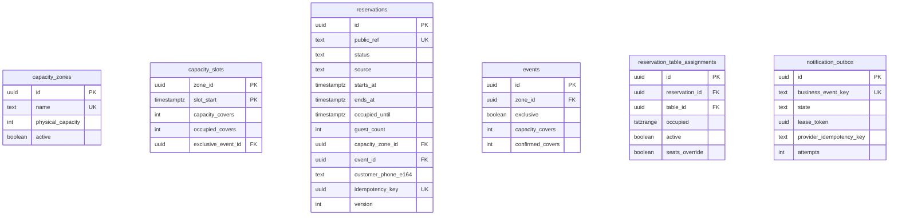

# Modello dati PostgreSQL — FireFlies Aperitif V1

> FASE 1 · rev. 2 del 19/10/2026 (revisione finale) · Stato: **proposta da approvare**. Questo documento **non è una migrazione**: lo schema Flyway `V1__…` sarà scritto da zero in FASE 2 a partire da qui.
> La bozza SQL precedente (`V1__initial_schema.sql`) non è disponibile (DECISION_LOG §4): nessun elemento `AUTO_TABLE` o di assegnazione automatica è stato ripreso.
> **Cambiato rispetto alla rev. 1**: `capacity_buckets` (contatore per fascia di arrivo) è sostituita da `capacity_zones` + `capacity_slots` (occupazione per quanti da 15 minuti); eventi con quota e flag `exclusive`; eccezione posti tavolo; outbox con lease, chiave di idempotenza verso il provider ed esiti incerti. Saldo: **+1 tabella**, giustificata in §3.3.

## 1. Convenzioni

| Tema | Regola |
|---|---|
| Nomi | `snake_case`, tabelle al plurale; prefissi `pk_`, `fk_`, `uq_`/`ux_`, `ck_`, `ex_`, indici `ix_` |
| Chiavi | `uuid` (`gen_random_uuid()`) per entità esposte via API; `bigint identity` per tabelle interne (storico, audit, tentativi); codice testuale per dati di riferimento |
| Tempo | istanti `timestamptz`; date locali `date`; orari di calendario `time` in **Europe/Rome**; intervalli `[inizio, fine)` |
| **Quanto** | 15 minuti. Orari di prenotazioni, eventi e quanti sono multipli di 15 min: `CHECK (extract(epoch FROM col)::bigint % 900 = 0)` (indipendente dal fuso; l'Italia ha offset a ore intere) |
| Denaro | `price_cents integer`, `NULL` = prezzo non comunicato |
| Enum | `text` + `CHECK (… IN (…))` |
| Colonne di servizio | `created_at`, `updated_at`; `version integer` per lock ottimistico dove la UI modifica in concorrenza |
| Cancellazioni | fisiche per configurazione senza storico; **mai** per prenotazioni (cambio di stato) né per media in uso (FK `RESTRICT`) |
| Estensioni | solo `btree_gist` |
| Seed | solo dati normativi (14 allergeni UE), template notifiche e la zona predefinita «Locale» **senza capienza attiva** (`active = false` finché il titolare non la imposta); dati demo solo nel profilo `local` |

## 2. Diagramma ER

```mermaid
erDiagram
  app_users ||--o{ audit_logs : "esegue"
  app_users ||--o{ reservation_status_history : "cambia"

  capacity_zones ||--o{ dining_areas : "contiene"
  capacity_zones ||--o{ service_windows : "fasce"
  capacity_zones ||--o{ capacity_slots : "quanti 15 min"
  capacity_zones |o--o{ events : "zona (null = tutto il locale)"
  dining_areas ||--o{ dining_tables : contiene
  service_windows ||--o{ booking_exceptions : "eccezioni"
  events |o--o{ capacity_slots : "esclusiva"

  capacity_zones |o--o{ reservations : "zona confermata"
  reservations }o--o| service_windows : "fascia di arrivo"
  reservations }o--o| events : "per l'evento"
  reservations ||--o{ reservation_status_history : storico
  reservations ||--o{ reservation_table_assignments : "tavoli (manuale)"
  dining_tables ||--o{ reservation_table_assignments : occupato
  reservations ||--o{ notification_outbox : notifiche
  notification_outbox ||--o{ notification_attempts : tentativi
  notification_templates ||--o{ notification_outbox : modello

  menu_categories ||--o{ menu_items : contiene
  menu_items ||--o{ menu_item_allergens : dichiara
  allergens ||--o{ menu_item_allergens : ""

  media_assets ||--o{ media_variants : varianti
  media_assets |o--o{ menu_items : foto
  media_assets |o--o{ events : locandina
  media_assets ||--o{ event_media : galleria
  events ||--o{ event_media : ""
  media_assets ||--o{ hero_slides : slide
  media_assets |o--o{ owners : "fronte/retro"
  media_assets |o--o{ staff_members : foto
  media_assets |o--o| site_content : "foto home"
```

Colonne principali della parte prenotazioni:

## 3. Tabelle, vincoli e indici

### 3.1 Identità e audit (`security`, `audit`)

**`app_users`**: `id uuid PK`; `email varchar(254)` con `ux_app_users_email UNIQUE (lower(email))`; `password_hash`; `display_name varchar(80)`; `role text CHECK (role IN ('OWNER','STAFF'))`; `active`; `failed_login_count int CHECK (>= 0)`; `locked_until`; `last_login_at`; `password_changed_at`; `created_at`, `updated_at`, `version`. Un solo ruolo per utente (OWNER include i permessi STAFF). Nessun account creato dalle migrazioni.

**`spring_session`, `spring_session_attributes`**: schema ufficiale Spring Session JDBC, copiato nella migrazione.

**`audit_logs`**: `id bigint identity PK`; `actor_user_id uuid null FK SET NULL` (null = sistema); `action text` (es. `RESERVATION_CONFIRMED`, `TABLE_SEATS_OVERRIDE`, `CAPACITY_CHANGED`, `NOTIFICATION_MANUAL_RESEND`); `object_type`; `object_id`; `metadata jsonb` **senza dati personali**; `occurred_at`. Indici `(object_type, object_id, occurred_at desc)`, `(occurred_at)`.

### 3.2 Spazi, fasce e regole (`dining`)

**`dining_areas`**: `id uuid PK`; **`zone_id uuid not null FK → capacity_zones RESTRICT`**; `name varchar(60)` (`UNIQUE (lower(name))`); `active`; `sort_order`. Nessuna capienza propria.

**`dining_tables`**: `id uuid PK`; `area_id not null FK RESTRICT`; `code varchar(10)` con `UNIQUE (area_id, code)`; `min_seats`, `max_seats smallint CHECK (min_seats >= 1 AND max_seats >= min_seats AND max_seats <= 30)`; `active`; `sort_order`. Nessuna colonna `combinable` (V2).

**`service_windows`**
| Colonna | Vincoli |
|---|---|
| id uuid | PK |
| **zone_id uuid** | not null FK → capacity_zones `RESTRICT` |
| iso_day smallint | `CHECK (BETWEEN 1 AND 7)` |
| name varchar(40) | |
| first_start, last_start time | `CHECK (last_start >= first_start)`; minuti multipli di 15; nessuna fascia oltre mezzanotte |
| slot_minutes smallint | `CHECK (IN (15, 30, 60))` |
| default_duration_minutes smallint | `CHECK (BETWEEN 30 AND 360 AND default_duration_minutes % 15 = 0)` |
| **max_covers int null** | limite di **presenze contemporanee** nella fascia, `CHECK (>= 0)`; null = capienza fisica della zona; non può superare la capienza fisica (controllo applicativo sotto lock della zona) |
| valid_from date, valid_to date null | `CHECK (valid_to IS NULL OR valid_to >= valid_from)` |
| active | |

Fasce sovrapposte nella stessa zona e giorno: rifiutate dall'applicazione sotto lock della zona. Indice `(zone_id, iso_day, active)`.

**`booking_policies`**: `id`; `effective_from date UNIQUE`; **`confirmation_mode text CHECK (confirmation_mode = 'MANUAL')`**; `web_booking_enabled`; `min_lead_minutes CHECK (BETWEEN 0 AND 10080)`; `max_advance_days CHECK (BETWEEN 1 AND 365)`; `max_party_size_web CHECK (BETWEEN 1 AND 50)`; `pending_expiry_minutes_before_start CHECK (BETWEEN 0 AND 1440)`; `created_by`, `created_at`.

**`booking_exceptions`**: `id`; `service_date date`; `service_window_id null FK CASCADE` (null = tutte le fasce del giorno); `kind CHECK (IN ('CLOSED','CAPACITY_OVERRIDE'))`; `capacity_override int null` con `CHECK ((kind = 'CAPACITY_OVERRIDE') = (capacity_override IS NOT NULL))` e `>= 0` (limite di presenze per quella data); `reason varchar(140)`; `created_by`, `created_at`. `UNIQUE NULLS NOT DISTINCT (service_date, service_window_id)`. `CLOSED` blocca gli arrivi ordinari, non cambia la capienza dei quanti.

### 3.3 Capienza (`capacity`)

**`capacity_zones`** — *giustificazione della nuova tabella*: le richieste di eventi «limitati a un'area» e di capienza fisica non superabile richiedono un'entità che rappresenti uno **spazio fisicamente separato** con la sua capienza; le aree dei tavoli non bastano perché più aree possono stare nella stessa stanza.
| Colonna | Vincoli |
|---|---|
| id uuid | PK |
| name varchar(40) | `UNIQUE (lower(name))` |
| physical_capacity int | `CHECK (physical_capacity BETWEEN 0 AND 1000)` |
| active boolean | prenotazioni possibili solo su zone attive |
| sort_order, version, updated_at | |

La riga della zona è anche il **punto di sincronizzazione** tra conferme (`FOR SHARE`) e cambi di capienza (`FOR UPDATE`), BOOKING_RULES §3.5.

**`capacity_slots`** — registro di occupazione (sostituisce `capacity_buckets`)
| Colonna | Vincoli |
|---|---|
| zone_id uuid | FK → capacity_zones `RESTRICT` |
| slot_start timestamptz | **PK `(zone_id, slot_start)`**; `ck_slot_aligned` (multiplo di 15 min) |
| capacity_covers int | `CHECK (>= 0)`; capienza effettiva del quanto calcolata alla creazione e aggiornata dai cambi di capienza |
| occupied_covers int | `CHECK (>= 0)` |
| exclusive_event_id uuid null | FK → events `RESTRICT`; quanto riservato a un evento esclusivo |
| updated_at | |

- **`ck_slot_not_overbooked CHECK (occupied_covers <= capacity_covers)`** — ultima difesa.
- `ix_slots_event (exclusive_event_id) WHERE exclusive_event_id IS NOT NULL`.
- Righe create **solo** per i quanti toccati da conferme o eventi esclusivi (pochi: ≈ 30–100 al giorno per zona). Pulizia delle righe più vecchie di 13 mesi.
- Lettura per la dashboard: `WHERE zone_id = ? AND slot_start >= ? AND slot_start < ?` sulla PK.

### 3.4 Prenotazioni (`reservation`)

**`reservations`**
| Colonna | Tipo | Vincoli / note |
|---|---|---|
| id | uuid | PK |
| public_ref | varchar(12) | UNIQUE, casuale leggibile (`FF-7K3Q9M`) |
| status | text | `CHECK (IN ('PENDING','CONFIRMED','REJECTED','CANCELLED','COMPLETED','NO_SHOW'))` |
| status_reason | text null | `CHECK (IN ('EXPIRED','NO_CAPACITY','CUSTOMER_REQUEST','VENUE_DECISION','EVENT_CANCELLED','DUPLICATE','OTHER'))` |
| source | text | `CHECK (IN ('WEB','PHONE','EMAIL'))` |
| reservation_date | date | data locale dell'arrivo |
| starts_at, ends_at | timestamptz | `CHECK (ends_at > starts_at)`; entrambi allineati a 15 min |
| **occupied_until** | timestamptz null | fine effettiva dell'occupazione; `= ends_at` alla conferma, anticipata da uscita anticipata/no-show; `CHECK (occupied_until IS NULL OR (occupied_until > starts_at AND occupied_until <= ends_at))`, allineato |
| guest_count | smallint | `CHECK (BETWEEN 1 AND 50)` |
| service_window_id | uuid null | FK `RESTRICT`; fascia di arrivo (ordinarie) |
| event_id | uuid null | FK `RESTRICT` |
| **capacity_zone_id** | uuid null | FK `RESTRICT`; preferenza mentre `PENDING`, zona definitiva dalla conferma |
| customer_name | varchar(80) | null solo se anonimizzata |
| customer_phone_e164 | varchar(16) | `CHECK (~ '^\+[1-9][0-9]{6,14}$')`; null solo se anonimizzata |
| customer_email | varchar(254) null | |
| customer_notes, internal_note | varchar(500) null | |
| needs_callback | boolean | ex «da contattare» |
| privacy_notice_version, privacy_ack_at | | obbligatori per WEB |
| idempotency_key | uuid null | `UNIQUE` |
| request_fingerprint | char(64) null | SHA-256 del payload normalizzato |
| created_by_user_id, handled_by_user_id | uuid null | FK `SET NULL` |
| confirmed_at, closed_at, anonymized_at | timestamptz null | |
| created_at, updated_at, version | | |

Vincoli:
- `ck_res_target`: `event_id IS NOT NULL OR service_window_id IS NOT NULL`.
- **`ck_res_occupying`**: `status NOT IN ('CONFIRMED','COMPLETED','NO_SHOW') OR (capacity_zone_id IS NOT NULL AND occupied_until IS NOT NULL)` — chi occupa posti ha sempre zona e intervallo.
- `ck_res_web_privacy`: `source <> 'WEB' OR (privacy_ack_at IS NOT NULL AND privacy_notice_version IS NOT NULL)`.
- `ck_res_anonymized`: `anonymized_at IS NOT NULL OR (customer_phone_e164 IS NOT NULL AND customer_name IS NOT NULL)`.
- **`ux_res_web_duplicate`**: `UNIQUE (customer_phone_e164, starts_at) WHERE source = 'WEB' AND status IN ('PENDING','CONFIRMED')`.

Indici:
- `ix_res_date_status (reservation_date, status)`;
- `ix_res_pending_start (starts_at) WHERE status = 'PENDING'` (scadenze);
- **`ix_res_zone_time` GiST `(capacity_zone_id, tstzrange(starts_at, occupied_until)) WHERE status IN ('CONFIRMED','COMPLETED','NO_SHOW')`** — elenco conflitti e riconciliazione per intervallo;
- `ix_res_event (event_id, status) WHERE event_id IS NOT NULL`;
- `ix_res_phone (customer_phone_e164)`; `ix_res_created (created_at desc)`.

**`reservation_table_assignments`**
| Colonna | Vincoli |
|---|---|
| id uuid | PK |
| reservation_id, table_id | FK `RESTRICT` |
| occupied tstzrange | `[starts_at, occupied_until)`; `CHECK (lower_inc(occupied) AND NOT upper_inc(occupied) AND NOT isempty(occupied))` |
| active boolean | |
| **seats_override** boolean | default false |
| **seats_override_by** uuid null, **seats_override_reason** varchar(200) null | `ck_override_complete CHECK (NOT seats_override OR (seats_override_by IS NOT NULL AND seats_override_reason IS NOT NULL))` |
| assigned_by, assigned_at, released_at | |

- **`ex_table_no_overlap EXCLUDE USING gist (table_id WITH =, occupied WITH &&) WHERE (active)`**.
- `UNIQUE (reservation_id, table_id) WHERE active`; `ix_assign_res (reservation_id)`.
- Che `seats_override_by` sia un OWNER è garantito dall'applicazione (+ audit); la colonna conserva chi ha deciso.

**`reservation_status_history`**: `id bigint identity PK`, `reservation_id FK`, `from_status null`, `to_status`, `reason null`, `note varchar(300) null`, `changed_by_user_id null` (null = cliente web o sistema), `changed_at`. Indice `(reservation_id, changed_at)`. Registra anche le modifiche (`from_status = to_status`, nota sintetica senza dati personali).

### 3.5 Eventi (`event`)

**`events`**
| Colonna | Vincoli |
|---|---|
| id uuid, slug varchar(80) UNIQUE `CHECK (slug ~ '^[a-z0-9]+(-[a-z0-9]+)*$')`, title varchar(120) | |
| kind, status | `kind CHECK (IN ('SERATA','FORMAT'))`, `status CHECK (IN ('DRAFT','PUBLISHED','CANCELLED'))` |
| starts_at, ends_at | `CHECK (ends_at IS NULL OR starts_at IS NULL OR ends_at > starts_at)`; allineati a 15 min se presenti |
| **zone_id** | null = tutto il locale; FK → capacity_zones |
| **exclusive** boolean | default **true** (blocca il servizio ordinario nei suoi quanti) |
| booking_mode | `CHECK (IN ('NONE','REQUEST'))` |
| capacity_covers int null | quota evento |
| **confirmed_covers int** | default 0, `CHECK (>= 0)` |
| artist, summary, body, poster_media_id | |
| created/updated, version | |

- `ck_event_published_has_date`: `status <> 'PUBLISHED' OR kind = 'FORMAT' OR starts_at IS NOT NULL`.
- `ck_event_booking_complete`: `booking_mode = 'NONE' OR (starts_at IS NOT NULL AND ends_at IS NOT NULL AND capacity_covers IS NOT NULL)`.
- **`ck_event_quota CHECK (capacity_covers IS NULL OR confirmed_covers <= capacity_covers)`**.
- Indici: `(status, starts_at)`; GiST `tstzrange(starts_at, ends_at)`.

La quota evento sta **sulla riga evento** (niente tabella contatori separata): il lock della riga evento serializza le conferme dello stesso evento.

**`event_media`**: PK `(event_id, media_id)`, `sort_order`; FK `RESTRICT` sui media.

### 3.6 Menu (`menu`) — invariato dalla rev. 1
- **`menu_categories`**: `id uuid PK`, `slug UNIQUE`, `name varchar(40)`, `hint varchar(80)`, `sort_order`, `visible`.
- **`menu_items`**: `id uuid PK`, `category_id FK RESTRICT`, `name varchar(80)`, `description varchar(400)`, `ingredients varchar(400) null`, **`price_cents int null CHECK (price_cents BETWEEN 0 AND 100000)`**, `photo_media_id FK RESTRICT null`, `allergens_status CHECK (IN ('UNDECLARED','DECLARED'))` («nessun allergene» ≠ «non ancora dichiarati»), `allergens_verified_at`, `allergens_verified_by`, `visible`, `sort_order`, `version`; `ck_item_allergens_verified: allergens_status = 'UNDECLARED' OR allergens_verified_at IS NOT NULL`; indice `(category_id, sort_order)`.
- **`allergens`**: `code text PK` (14 allergeni Reg. UE 1169/2011, Allegato II), `name_it`, `sort_order` — seed normativo.
- **`menu_item_allergens`**: PK `(menu_item_id, allergen_code)`, FK `CASCADE` sulla voce.

### 3.7 Media e contenuti (`media`, `content`)
Unica novità della rev. 2: `site_settings.sms_enabled boolean not null default false`, uno dei tre interruttori necessari per un SMS reale (ADR-0005).
- **`media_assets`**: `id uuid PK`; `storage_key UNIQUE` casuale (mai il nome file dell'utente); `status CHECK (IN ('PENDING_UPLOAD','PROCESSING','READY','REJECTED'))`; `mime_type CHECK (IN ('image/jpeg','image/png','image/webp'))`; `bytes CHECK (BETWEEN 1 AND 5242880)`; `width`, `height`; `sha256`; `alt_text varchar(250)` con `CHECK (status <> 'READY' OR alt_text IS NOT NULL)`; `credit`, `consent_note`; `in_gallery`, `gallery_order`; `uploaded_by`, `created_at`, `ready_at`, `upload_expires_at`. Indici sulla galleria e sugli upload in attesa.
- **`media_variants`**: `UNIQUE (media_id, variant)`, `variant CHECK (IN ('W480','W960','W1600'))`, `storage_key UNIQUE`, dimensioni; FK `CASCADE`.
- **Uso dei media**: FK reali `ON DELETE RESTRICT` (`menu_items.photo_media_id`, `events.poster_media_id`, `event_media`, `hero_slides`, `owners.front/back_media_id`, `staff_members.media_id`, `site_content.hero_media_id`) → `409 MEDIA_IN_USE`; vista `media_usages_v` per il messaggio «è usata in…».
- **`site_settings`** (riga unica `CHECK (id = 1)`): indirizzo, `map_query`, `map_mode CHECK (IN ('CONSENT','AUTO'))`, telefono ed email pubblici, Instagram, `address_confirmed`, `hours_confirmed`, `menu_hero_interval_sec CHECK (BETWEEN 10 AND 600) DEFAULT 60`, `sms_enabled`, `version`.
- **`site_content`** (riga unica): `hero_claim`, `hero_lead`, `hero_media_id`, `story_title`, `story_text`, `story_confirmed`, `version`. **`site_sections`**: `code PK`, `enabled`, `sort_order`.
- **`opening_hours`** (orari **pubblici**): `iso_day`, `opens_at`, `closes_at`, `closes_next_day`, `closed`. **`opening_exceptions`**: `date UNIQUE`, `closed`, orari alternativi, nota.
- **`hero_slides`**: `page CHECK (IN ('MENU','HOME'))`, `media_id FK RESTRICT`, `sort_order`, `enabled`; `UNIQUE (page, sort_order) DEFERRABLE INITIALLY DEFERRED`.
- **`owners`**, **`staff_members`**: nome, ruolo, testi, foto (FK `RESTRICT`), ordine, visibilità. **`announcements`**: `text varchar(140)`, `tone CHECK (IN ('INFO','IMPORTANT'))`, `active`, `visible_until`.

### 3.8 Notifiche (`notification`)

**`notification_templates`**: PK `(code, channel)`, `channel CHECK (IN ('EMAIL','SMS'))`, `subject null`, `body`, `active`, `version`; `CHECK (channel <> 'SMS' OR char_length(body) <= 320)`.

**`notification_outbox`**
| Colonna | Vincoli / note |
|---|---|
| id uuid | PK |
| business_event_key varchar(160) | **UNIQUE** — un fatto, una notifica (es. `reservation:{id}:CONFIRMED:CUSTOMER:EMAIL`; per le modifiche include la `version`) |
| aggregate_type, aggregate_id | |
| channel | `EMAIL` / `SMS` |
| recipient_kind, recipient | |
| template_code, payload jsonb minimo | |
| state | `CHECK (IN ('PENDING','SENDING','SENT','DELIVERED','UNCERTAIN','FAILED','DEAD','SKIPPED'))` |
| skip_reason | null; es. `NO_EMAIL`, `SMS_DISABLED`, `SUPERSEDED`, `EXPIRED` |
| attempts smallint | `CHECK (BETWEEN 0 AND 10)` |
| next_attempt_at | |
| **lease_token** uuid null, **locked_until** timestamptz null | `CHECK (state <> 'SENDING' OR (lease_token IS NOT NULL AND locked_until IS NOT NULL))` |
| **provider_idempotency_key** varchar(80) | stabile tra i ritentativi automatici; cambia solo con un reinvio manuale |
| manual_resend_count smallint | default 0 |
| **expires_at** timestamptz | oltre questa data il messaggio non ha più senso (es. dopo l'orario della prenotazione) → `SKIPPED (EXPIRED)` |
| last_error_code | senza dati personali |
| created_at, sent_at, purge_after | |

Indici: **`ix_outbox_ready (next_attempt_at) WHERE state = 'PENDING'`**, `ix_outbox_lease (locked_until) WHERE state = 'SENDING'`, `ix_outbox_attention (created_at) WHERE state IN ('UNCERTAIN','FAILED','DEAD')`, `ix_outbox_aggregate (aggregate_type, aggregate_id)`.

**`notification_attempts`**
| Colonna | Note |
|---|---|
| id bigint identity | PK |
| outbox_id | FK `CASCADE` |
| attempt_no smallint | `UNIQUE (outbox_id, attempt_no)` |
| provider | `fake`, poi il provider scelto |
| idempotency_key_used | chiave inviata al provider (null se non supportata) |
| started_at | scritto e **committato prima** della chiamata al provider |
| finished_at | null = esito mai registrato (worker interrotto) |
| outcome | null finché in corso; `CHECK (IN ('ACCEPTED','REJECTED_PERMANENT','TRANSIENT_ERROR','UNKNOWN'))` |
| http_status, provider_message_id, error_code, duration_ms | |

## 4. Invarianti

| # | Invariante | Dove è garantita |
|---|---|---|
| I-1 | In ogni zona e quanto, persone confermate presenti ≤ capienza effettiva | `ck_slot_not_overbooked` + lock ordinati dei quanti |
| I-2 | Registro = realtà: per ogni quanto, `occupied_covers` = somma delle persone delle prenotazioni che lo occupano | transazioni uniche + **query di riconciliazione** nei test (verificata nello spike 2) |
| I-3 | Prenotazioni e quota di un evento: confermati ≤ quota | `ck_event_quota` + lock della riga evento |
| I-4 | Nessun quanto di un evento esclusivo contiene coperti ordinari | lock ordinati dei quanti in pubblicazione e conferma (spike 2: 0 violazioni) + test di riconciliazione |
| I-5 | Un tavolo non ha due assegnazioni attive sovrapposte | `ex_table_no_overlap` |
| I-6 | Posti del tavolo < persone solo con eccezione OWNER motivata e auditata | `ck_override_complete` + controllo ruolo + audit |
| I-7 | Chi occupa posti ha zona e intervallo | `ck_res_occupying` |
| I-8 | Nessun doppio invio web stesso telefono e orario | `ux_res_web_duplicate` + chiave di idempotenza |
| I-9 | Un fatto di business accoda al massimo una notifica | `business_event_key UNIQUE` |
| I-10 | Un messaggio è in carico a un solo worker alla volta; un worker con lease scaduto non registra esiti | `FOR UPDATE SKIP LOCKED` + `lease_token` negli update (spike 2) |
| I-11 | Auto-conferma non attivabile senza nuova migrazione | `CHECK (confirmation_mode = 'MANUAL')` |
| I-12 | Una foto in uso non si cancella | FK `RESTRICT` |
| I-13 | Ogni cambio di stato è storicizzato | stessa transazione (test) |

## 5. V1 / V2 nel modello

| V1 | V2 (nessuna colonna ora) |
|---|---|
| zone fisiche con capienza, quanti da 15 min | ottimizzazione della capienza, overbooking controllato, durate variabili automatiche |
| tavoli con posti, assegnazione manuale, eccezione OWNER | `combinable`, gruppi di tavoli, planimetria, scelta automatica |
| `confirmation_mode = 'MANUAL'` | `AUTO` con policy |
| eventi esclusivi o condivisi sulla stessa capienza | prenotazione di posti riservati all'evento (hold) |
| — | lista d'attesa, clienti senza prenotazione, CRM |
