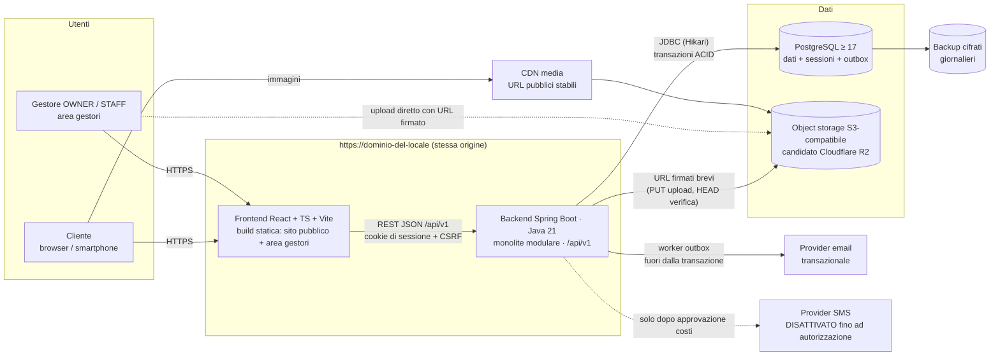
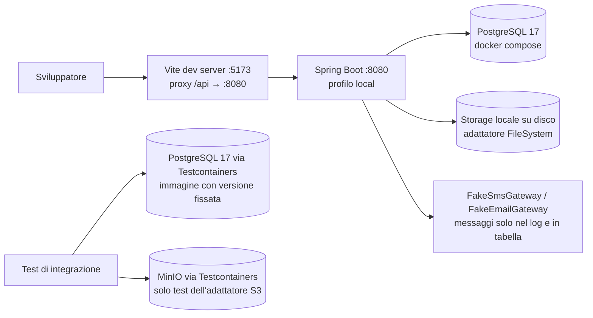
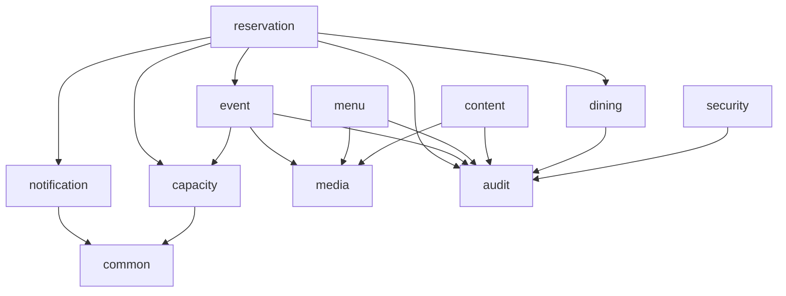

# Architettura di sistema e moduli — FireFlies Aperitif

> FASE 1 · 19/10/2026 · Stato: **proposta da approvare**. Nessun codice backend scritto.
> Decisioni di riferimento: [DECISION_LOG](DECISION_LOG.md). Modello dati: [DATA_MODEL](DATA_MODEL.md). Regole: [BOOKING_RULES](BOOKING_RULES.md). API: [API_CONTRACT](API_CONTRACT.md).

## 1. Diagramma architetturale (produzione)



**Punti chiave**

1. **Stessa origine** per frontend e `/api/v1`: il cookie di sessione è `HttpOnly; Secure; SameSite=Lax`, niente CORS aperto. Come servire i file statici (dal backend stesso o da una CDN davanti) si decide in FASE 8 con l'hosting (P-14).
2. **Un solo processo JVM**: contiene API, scheduler e worker dell'outbox. Nessun broker, nessuna cache esterna.
3. **PostgreSQL** è la fonte di verità per dati, sessioni (Spring Session JDBC) e coda notifiche (transactional outbox).
4. **Le foto non transitano dal backend**: il browser carica direttamente sullo storage con un URL firmato di pochi minuti; il backend verifica e registra solo i metadati.
5. **Chiamate esterne mai dentro una transazione o un lock**: email/SMS partono dal worker dopo il commit.

## 2. Diagramma ambiente locale e test



Verificato nel container il 19/10: Docker avviabile, PostgreSQL 17.11 con `btree_gist` funzionante (vedi [evidenza spike](evidence/FASE1_SQL_SPIKE.md)).

## 3. Stack e versioni (da fissare in FASE 2)

Valori letti su Maven Central il 19/10/2026; le date di fine supporto vanno confermate sul calendario ufficiale spring.io prima di fissarle.

| Componente | Proposta | Note |
|---|---|---|
| Java | 21 (LTS) | presente nel container (21.0.12) |
| Spring Boot | **4.1.x** (oggi 4.1.1) | gestisce Spring Framework 7.0.9, Spring Security 7.1.1, Spring Session 4.1.1, Hibernate 7.4.5, Jackson 3.1.5, Flyway 12.4.0, Testcontainers 2.0.5, driver PostgreSQL 42.7.13, Tomcat 11 |
| Build | Maven + wrapper `mvnw` | Maven 3.9.11 presente |
| Database | PostgreSQL 17 (dev/test); produzione ≥ 17 secondo il provider | estensioni: `btree_gist` (core contrib) |
| Migrazioni | Flyway (versione gestita da Boot) + `flyway-database-postgresql` | |
| API doc | springdoc-openapi 3.x (compatibile Boot 4.1) | oppure solo `openapi.yaml` scritto a mano (P-23) |
| Storage | AWS SDK v2 `s3` (compatibile R2/MinIO) | adattatore dietro interfaccia `MediaStorage` |
| Immagini | `ImageIO` + TwelveMonkeys (lettura WebP) | output JPEG ricodificato, EXIF rimosso (P-17) |
| Confini moduli | Spring Modulith 2.1.x **solo in test** (verifica dipendenze) | facoltativo (P-18); compatibilità con Boot 4.1 da verificare |

**Escluso**: Redis, Kafka, RabbitMQ, Kubernetes, MongoDB, Spring Cloud, Lombok (scelta di stile: record Java 21 per i DTO), MapStruct.

## 4. Struttura dei moduli Spring Boot

```text
backend/
  pom.xml, mvnw
  src/main/java/it/fireflies/
    FirefliesApplication.java
    common/          errori problem+json, Clock, fuso Europe/Rome, paginazione, CurrentActor, ID
    security/        utenti, login/logout, sessioni JDBC, CSRF, rate limit login, ruoli
    audit/           registro azioni amministrative (API interna AuditLog)
    media/           asset, upload-intent/finalize, varianti, storage S3/FileSystem, verifica uso
    content/         impostazioni sito, orari pubblici, sezioni, titolari, staff, hero, avvisi, galleria
    menu/            categorie, voci, allergeni UE
    dining/          aree, tavoli, fasce prenotabili, policy, eccezioni di calendario
    capacity/        contatori di coperti (fascia-giorno ed evento), consumo/rilascio atomici
    event/           eventi, pubblicazione, capienza evento, porta OrdinaryBookingConflicts
    reservation/     richieste, state machine, modifiche, assegnazione tavoli, scadenze, storico
    notification/    outbox, template, worker, EmailGateway, SmsGateway (+ Fake), tentativi
  src/main/resources/
    application.yml, application-local.yml, application-test.yml, application-prod.yml
    db/migration/    V1__… (scritte in FASE 2)
  src/test/java/…
frontend/            copia del mockup approvato, migrata gradualmente a servizi API
infra/               compose.yaml (PostgreSQL), .env.example senza segreti
docs/
```

Dentro ogni modulo, solo dove serve: `api/` (controller + DTO record), `application/` (servizi transazionali), `domain/` (entità, enum, regole pure), `persistence/` (repository Spring Data). Ogni modulo espone **una facciata pubblica** (es. `CapacityLedger`, `ReservationQueries`); gli altri moduli non usano i suoi repository.

### Dipendenze ammesse tra moduli



- Nessun ciclo. Il controllo «un evento si sovrappone a prenotazioni ordinarie?» serve a `event` ma i dati stanno in `reservation`: `event` dichiara l'interfaccia `OrdinaryBookingConflicts` e `reservation` la implementa (inversione della dipendenza).
- `notification` non conosce `reservation`: riceve un comando di accodamento con un payload minimo già pronto.
- `security` fornisce l'autenticazione tramite Spring Security; i moduli leggono l'utente corrente da `common.CurrentActor`.

### Responsabilità e proprietà dei dati

| Modulo | Tabelle possedute | Chi scrive |
|---|---|---|
| security | `app_users`, `spring_session*` | OWNER (utenti), sistema (sessioni) |
| audit | `audit_logs` | tutti i moduli tramite `AuditLog` |
| media | `media_assets`, `media_variants` | OWNER, STAFF |
| content | `site_settings`, `site_sections`, `site_content`, `opening_hours`, `opening_exceptions`, `owners`, `staff_members`, `hero_slides`, `announcements` | OWNER (impostazioni, contenuti), STAFF (avvisi, galleria) |
| menu | `menu_categories`, `menu_items`, `allergens`, `menu_item_allergens` | OWNER, STAFF |
| dining | `dining_areas`, `dining_tables`, `service_windows`, `booking_policies`, `booking_exceptions` | OWNER |
| capacity | `capacity_buckets` | solo tramite `CapacityLedger` (reservation, event) |
| event | `events`, `event_media` | OWNER, STAFF |
| reservation | `reservations`, `reservation_status_history`, `reservation_table_assignments` | pubblico (crea PENDING), STAFF/OWNER, sistema (scadenze) |
| notification | `notification_templates`, `notification_outbox`, `notification_attempts` | sistema; OWNER per i template |

## 5. Processi in background (stesso JVM)

| Job | Frequenza | Cosa fa | Concorrenza |
|---|---|---|---|
| Worker outbox | ogni 10 s | prende fino a 20 messaggi con `FOR UPDATE SKIP LOCKED`, li marca `SENDING` con lease, commit, invia, registra il tentativo | sicuro anche con 2 istanze |
| Scadenza richieste | ogni 5 min | `PENDING` oltre la scadenza → `REJECTED` motivo `EXPIRED` (BOOKING_RULES §6) | update condizionale per riga |
| Pulizia upload | ogni ora | asset `PENDING_UPLOAD` scaduti → cancellati da storage e DB | idempotente |
| Retention dati | ogni notte 03:30 | anonimizza prenotazioni oltre il periodo concordato (P-13) | idempotente |
| Pulizia outbox | ogni notte | elimina il payload dei messaggi inviati da oltre 30 giorni | idempotente |

Lo scheduler usa `Clock` iniettato (test deterministici) e il fuso `Europe/Rome` per le regole di calendario.
